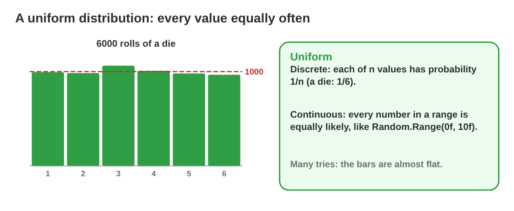
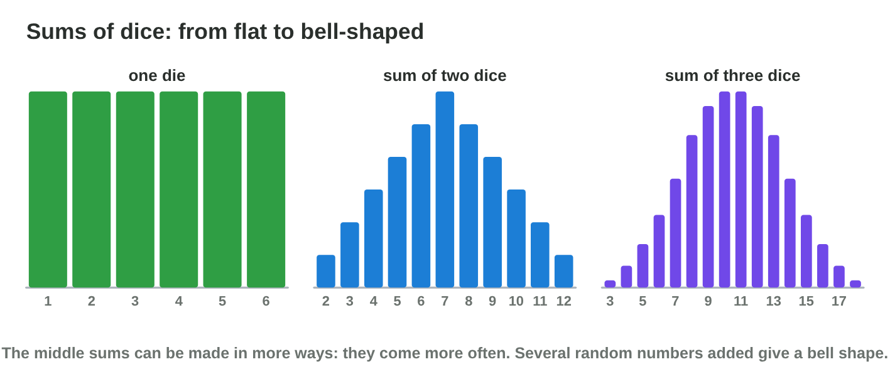
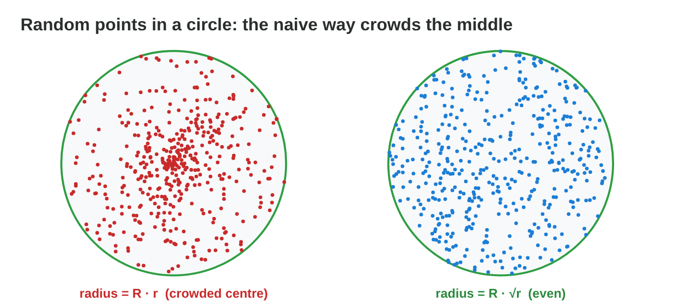

This page is the interactive version of the lesson notes (PDF). Each section
has a short summary, a picture, a **Do it** task and one set of questions.
The full explanations, examples and exercises are in the notes.

## Key terms



## 23.1 Distributions and histograms

- A **distribution**: every value with its probability; the sum is 1.
- A **histogram**: how often each value came in many tries.
- Chest: common 0.6, rare 0.3, epic 0.09, legendary 0.01.

::: {.callout-warning title="Watch out!"}
20 tries say little; use hundreds or thousands.
:::

::: {.callout-note title="Do it · Write a distribution"}
Write the distribution of the number of heads with two coins; check that the
sum is 1.
:::

::: {.callout-tip title="Try it 1 · Distributions"}
Choose the probability.

::: {.match extra="1/3|2/3"}
0 heads with two coins
:   1/4

1 head with two coins
:   1/2

2 heads with two coins
:   1/4

all values of a distribution together
:   1
:::
:::

## 23.2 The uniform distribution

- Every value equally likely. Discrete: 1/n each.
- Continuous: the chance of a part = its length ÷ the whole length.

{width=94%}

::: {.callout-warning title="Watch out!"}
Uniform rarities make legendary items common (25 % with four rarities).
:::

::: {.callout-note title="Do it · Uniform chances"}
Random.Range(0, 8): P(5)? Random.Range(0f, 10f): P(from 7 to 10)?
:::

::: {.callout-tip title="Try it 2 · Uniform"}
Choose the probability.

::: {.match extra="1/7|3/7"}
Random.Range(0, 8) gives 5
:   1/8

Random.Range(0f, 10f) gives 7 … 10
:   3/10

a bat after 2 … 6 s comes in 2 … 3 s
:   1/4

one rarity of four, uniform
:   1/4
:::
:::

## 23.3 Weighted random choice

- **P(i) = wᵢ ÷ sum of the weights.**
- Pick: cumulative weights, r from 0 to the sum, the first cumulative value
  above r.
- A **loot table** is a list of items with weights. Weight 0 = never.

{width=94%}



::: {.callout-warning title="Watch out!"}
Use r < cumulative, so that weight 0 never drops.
:::

::: {.callout-note title="Do it · A loot table"}
In **Loot Table Lab**, open 1000 chests; then make epic 5 % and write the
weights.
:::

::: {.callout-tip title="Try it 3 · Weights"}
Use Loot Table Lab. Choose the right answer.

::: {.match extra="9/60|0 %"}
P(epic) with 60, 30, 9, 1
:   9 %

P(shield) with sword 3, shield 1
:   1/4

r = 72 with cumulative 60, 90, 99, 100
:   rare

r = 99.4 with cumulative 60, 90, 99, 100
:   legendary
:::
:::

## 23.4 Bell shapes from sums

- The sum of several random numbers is **bell-shaped**.
- Middle values are common, extremes rare.
- Damage 3 … 18: three dice instead of Random.Range(3, 19).

{width=94%}

::: {.callout-warning title="Watch out!"}
One die × 3 is not three dice: it stays uniform, with gaps.
:::

::: {.callout-note title="Do it · Shapes"}
In **Distribution Shape Lab**, compare 1 die and 3 dice; note the most
common values.
:::

::: {.callout-tip title="Try it 4 · Sums"}
Choose the right answer.

::: {.match extra="1/16|18"}
P(sum 3) with three dice
:   1/216

the most common sum of two dice
:   7

values of one die × 3
:   3, 6, 9, 12, 15, 18

the shape of three dice added
:   bell-shaped
:::
:::

## 23.5 Random points in an area

- Rectangle: random x and random y.
- Circle: angle 2π·r₁ and **radius R·√r₂**.
- Without √, the points crowd the centre.

{width=94%}



::: {.callout-warning title="Watch out!"}
Points from the square around a circle can land outside the room.
:::

::: {.callout-note title="Do it · The round room"}
Scatter 1000 coins both ways in **Distribution Shape Lab**; count the coins in
the inner half of the radius.
:::

::: {.callout-tip title="Try it 5 · Areas"}
Use Distribution Shape Lab. Choose the right answer.

::: {.match extra="R · r²|the edge"}
the even radius in a circle
:   R · √r

where R · r crowds the points
:   the centre

the share of area inside half the radius
:   1/4

coins in the inner half with √r (of 1000)
:   about 250
:::
:::

## Game challenge: Loot Forge {.challenge}

Work alone. Use every section of today.

The loot designer asks: **P(epic)**, weights that do not add up to 100, a
**cumulative** pick, **steady damage**, **crowded coins**, and **weight 0**.



::: {.callout-tip title="Try it 6 · The forge"}
Choose the right answer.

::: {.match extra="Random.Range(3, 19)|it drops once"}
r = 93.5, cumulative 60, 90, 99, 100
:   epic

steady damage 3 … 18
:   the sum of three dice

an item with weight 0
:   it never drops

coins crowd the centre
:   use R · √r
:::
:::

::: {.callout-tip title="Try it 7 · Design (harder)"}
Choose the right answer.

::: {.match extra="1 in 100|weight 200"}
legendary 1 in 200 with a total of 200
:   weight 1

weights 5, 3, 2: P(the second)
:   3/10

cumulative 50, 80, 95, 100 and r = 81
:   the third option

Random.Range(0f, 20f) below 5
:   1/4
:::
:::

::: {.callout-tip title="Try it 8 · Code (harder)"}
Choose what the code does.

::: {.match extra="it crashes|it is always 0"}
r = Random.value * sum, then r < cumulative
:   a weighted pick

Random.Range(1, 7) + Random.Range(1, 7)
:   the sum of two dice

a = 2π · Random.value; rad = R · √(Random.value)
:   an even point in a circle

Random.Range(1, 6) * 3
:   one die times three, without 18
:::
:::

## Summary {.summary}

- A distribution gives every value a probability; histograms show it.
- Uniform: all values equally likely.
- Weighted: weight ÷ sum; pick with cumulative weights.
- Sums of random numbers are bell-shaped.
- In a circle, use radius R · √r for an even spread.
