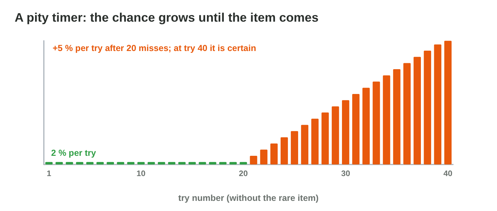
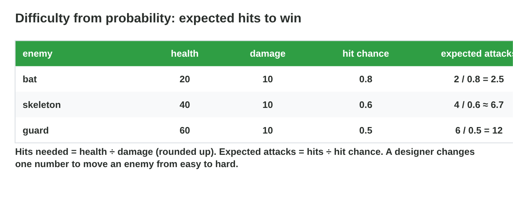

::: {.lead}
The update of *Torch Hall* adds a golden torch that drops from bats with a
chance of 5 %. In the first test week, some players get it after three bats,
others after a hundred, and a few write angry reviews. The new skeleton is so
easy that nobody notices it, and the chests give more coins than the shop can
use. **Game balance** is the work of setting such numbers so that the game is
fair, challenging and fun. In lectures 20–23 you learned probability,
expected value and random distributions. In this lesson you **use** them to
balance a game: drop rates, waiting times, pity timers, rewards and
difficulty. Every section ends with a short task.
:::

## Key terms



## 24.1 Drop rates and "at least once"

A **drop rate** is the probability that one try gives the item. Players care
about another number: the chance to have it after their tries (@fig-least).

::: {.callout-important title="Definition 24.1 — At least one drop in n tries"}
With drop rate p per try and independent tries,
$$P(\text{at least one in } n) = 1 - (1 - p)^n.$$
The complement "none in n tries" is (1 − p)ⁿ (lecture 20). The average
number of tries is 1/p (lecture 21).
:::

{#fig-least width=94%}

::: {.callout-note title="Example 24.1 — The golden torch"}
p = 0.05:

1. After 20 bats: 1 − 0.95²⁰ ≈ 1 − 0.36 = **0.64**. Not 100 %!
2. After 45 bats: 1 − 0.95⁴⁵ ≈ **0.90**.
3. The average is 1/0.05 = 20 bats, but 10 % of the players need more than 45.
:::

::: {.callout-warning title="Common mistake"}
"5 % per bat, so after 20 bats it is 100 %." Chances of independent tries do
not add up; use the complement.
:::

::: {.callout-note title="Do it · Chances of a drop"}
A pet drops with p = 0.1. Compute the chance to have it after 5, 10 and 30
tries.

*Your result:* three probabilities.
:::

## 24.2 How many tries do most players need?

A designer often starts from the question: "Within how many tries should 90 %
of the players have the item?"

::: {.callout-important title="Definition 24.2 — Tries for a share of players"}
The share q of players have the item after n tries when 1 − (1 − p)ⁿ ≥ q.
Solving for n:
$$n \ge \frac{\ln(1 - q)}{\ln(1 - p)}.$$
For q = 0.9: n ≥ ln 0.1 / ln(1 − p). You can also find n by trying values in a
table or in a simulator.
:::

::: {.callout-note title="Example 24.2 — 90 % within 20 bats"}
1. Wanted: 1 − (1 − p)²⁰ ≥ 0.9, so (1 − p)²⁰ ≤ 0.1.
2. 1 − p ≤ 0.1^(1/20) ≈ 0.891, so p ≥ 0.109.
3. A drop rate of **11 %** gives 90 % of the players the torch within 20
   bats; the average wait is about 9 bats.
:::



::: {.callout-warning title="Common mistake"}
Setting p only from the average: with p = 1/20 "on average 20 tries" sounds
fine, but the long tail of unlucky players is what they remember.
:::

::: {.callout-note title="Do it · Find the rate"}
1. In **Drop Rate Lab**, find the drop rate that gives 90 % of the players the
   torch within 20 bats.
2. Check it with the formula.

*Your result:* a drop rate and a calculation.
:::

## 24.3 Pity timers

To protect unlucky players, many games add a **pity timer** (@fig-pity).

::: {.callout-important title="Definition 24.3 — Pity timer"}
A **pity timer** changes the chance after many misses: the item is
**guaranteed** after N tries without it, or its chance **grows** with every
miss. The tries are no longer independent, and the longest wait is limited.
:::

{#fig-pity width=94%}

::: {.callout-note title="Example 24.3 — A guarantee at 40"}
1. Torch with p = 5 % and a guarantee at bat 40.
2. Without the timer, 0.95³⁹ ≈ 13 % of the players would still wait after 39
   bats; with it, all have the torch at 40.
3. The average falls a little (from 20 to about 17 bats).
:::

::: {.callout-caution title="In game code"}
```csharp
int missesSinceTorch = 0;
void OnBatKilled() {
    bool drop = Random.value < 0.05f || missesSinceTorch >= 39;
    if (drop) { GiveTorch(); missesSinceTorch = 0; }
    else missesSinceTorch++;
}
```
:::

::: {.callout-warning title="Common mistake"}
Hiding a very low drop rate behind a pity timer and calling it "5 %". Be
honest with players about how drops work; many stores require shown odds for
paid random items.
:::

::: {.callout-note title="Do it · Pity"}
In **Drop Rate Lab**, switch on the pity timer at 40. What is the longest
wait now? What is the average?

*Your result:* two numbers.
:::

## 24.4 Rewards: expected value and the economy

The expected value of rewards controls how fast players get rich (lecture
21).

::: {.callout-important title="Definition 24.4 — Expected reward"}
For a chest with rarities of weight wᵢ and value vᵢ, the **expected reward**
is E = Σ vᵢ · wᵢ / Σ wᵢ. Compare E with the prices in the shop: if a sword
costs 300 coins and a chest gives 15 on average, a player needs about 20
chests for the sword.
:::

::: {.callout-note title="Example 24.4 — The chest and the shop"}
Common 60 (5 coins), rare 30 (20 coins), epic 10 (60 coins):

1. E = 0.6·5 + 0.3·20 + 0.1·60 = 3 + 6 + 6 = **15 coins**.
2. A sword for 300 coins needs about 300 / 15 = 20 chests.
3. Too slow? Raise the rare value to 30: E = 18, about 17 chests.
:::

::: {.callout-warning title="Common mistake"}
Balancing with the plain average of the values ((5 + 20 + 60) / 3 ≈ 28):
the game then gives far fewer coins than planned.
:::

::: {.callout-note title="Do it · The economy"}
A chest: 70 % gives 10 coins, 25 % gives 40 coins, 5 % gives 200 coins.
Compute E and the number of chests for a shield of 400 coins.

*Your result:* E and a number of chests.
:::

## 24.5 Difficulty from probability

Hit chances and damage make a fight easy or hard (@fig-difficulty).

::: {.callout-important title="Definition 24.5 — Expected attacks"}
Hits needed = ⌈health ÷ damage⌉. With hit chance h, the **expected number of
attacks** to win is hits ÷ h. Compare the expected attacks of the player and
of the enemy: the side that needs fewer attacks usually wins. A
**simulation** of many fights gives the win rate.
:::

{#fig-difficulty width=94%}

::: {.callout-note title="Example 24.5 — The skeleton is too easy"}
Player: 50 health, 10 damage, hit chance 0.7. Skeleton: 40 health, 12 damage,
hit chance 0.6.

1. Player: 4 hits ÷ 0.7 ≈ 5.7 attacks. Skeleton: ⌈50/12⌉ = 5 hits ÷ 0.6 ≈ 8.3
   attacks.
2. The simulation: the player wins about 88 % of fights.
3. The target for a normal enemy is 70–85 %: with 16 damage (4 hits ÷ 0.6 ≈ 6.7
   attacks) the player wins about 73 %.
:::



::: {.callout-warning title="Common mistake"}
Changing many numbers at once. Change one number a little, simulate, and
compare, so you know what made the difference.
:::

::: {.callout-note title="Do it · Tune an enemy"}
In **Difficulty Tuner**, make the skeleton a normal enemy (70–85 %), then a
boss (30–45 %). Write the values.

*Your result:* two sets of values with their win rates.
:::

## 24.6 Testing a balance with simulations

Formulas give the expected values; simulations show the whole distribution,
including the unlucky players.

::: {.callout-important title="Definition 24.6 — Balance by simulation"}
1. Write the rule as code (drop, fight, chest).
2. Run it many times (1000 or more) with random numbers.
3. Look at the average **and** at the extremes (the 10 % most unlucky).
4. Change one number and run again.
:::

::: {.callout-note title="Example 24.6 — 1000 players"}
1. Torch p = 5 %, no pity: average about 20 bats, the longest wait often over
   100.
2. With pity at 40: average about 17, longest 40.
3. The team keeps 5 % with pity: exciting early drops for some, no endless
   wait for anyone.
:::

::: {.callout-warning title="Common mistake"}
Testing only with your own luck in a few play sessions. Ten tries tell little;
1000 simulated players show what the community will feel.
:::

::: {.callout-note title="Do it · Simulate"}
Simulate 1000 players in **Drop Rate Lab** with p = 3 %, with and without a
pity timer at 50. Compare the average and the longest wait.

*Your result:* four numbers.
:::

## Case study: Balance Board

The balance team of *Torch Hall* checks six cards before the update: the
chance of a torch in 20 bats, a drop rate for "about 10 kills on average",
players who quit after 200 misses, the expected attacks against a skeleton, the
expected coins of a chest, and a skeleton that wins too often. The Game
challenge of the interactive lesson uses these cards. In the mini-game below
you answer each one.



## Further reading

Schreiber and Romero, *Game Balance* (2021), Chapters 17–19 (probability
and balance). Adams and Dormans, *Game Mechanics: Advanced Game Design*
(2012), Chapter 3.

## Exercises

1. p = 0.2. P(at least one in 3 tries)?
2. p = 0.05. P(none in 10 tries)?
3. Why is "5 % × 20 tries = 100 %" wrong?
4. What is the average number of tries with p = 0.04?
5. Write the formula for the tries that 90 % of players need.
6. p = 0.1. After how many tries do 90 % have the item? (Use ln 0.1 ≈ −2.30,
   ln 0.9 ≈ −0.105.)
7. What does a pity timer do?
8. Why does a pity timer lower the average a little?
9. Chest: 80 % 10 coins, 20 % 50 coins. E?
10. A hat costs 180 coins. How many chests of exercise 9 on average?
11. Enemy 30 health, player damage 10, hit chance 0.75. Expected attacks?
12. Why simulate if we have formulas?
13. Which share of fights should a normal enemy lose, in the target of this
    lesson?
14. Name one thing a simulation shows that the average does not.

## Answers to the exercises

::: {.answers}
1. 1 − 0.8³ = 1 − 0.512 = 0.488.
2. 0.95¹⁰ ≈ 0.60.
3. Independent chances do not add up; use 1 − (1 − p)ⁿ.
4. 1/0.04 = 25.
5. n ≥ ln(0.1) / ln(1 − p).
6. n ≥ 2.30 / 0.105 ≈ 21.9, so 22 tries.
7. It guarantees the item after N misses, or raises the chance after misses.
8. It cuts off the very long waits, which pull the average up.
9. 0.8·10 + 0.2·50 = 18.
10. 180 / 18 = 10.
11. 3 hits ÷ 0.75 = 4 attacks.
12. To see the whole distribution, including unlucky players and rare cases.
13. 70–85 % (the player wins that share).
14. For example the longest waits, or the share of unlucky players.
:::
