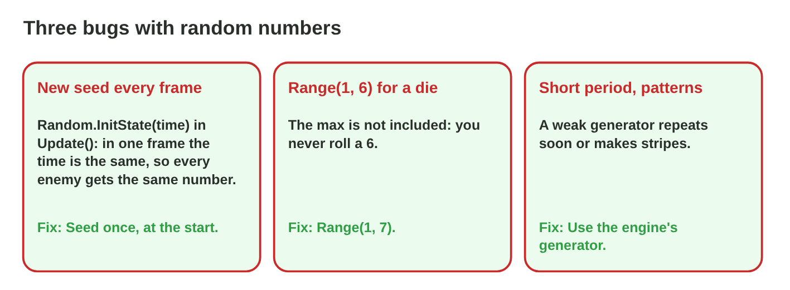
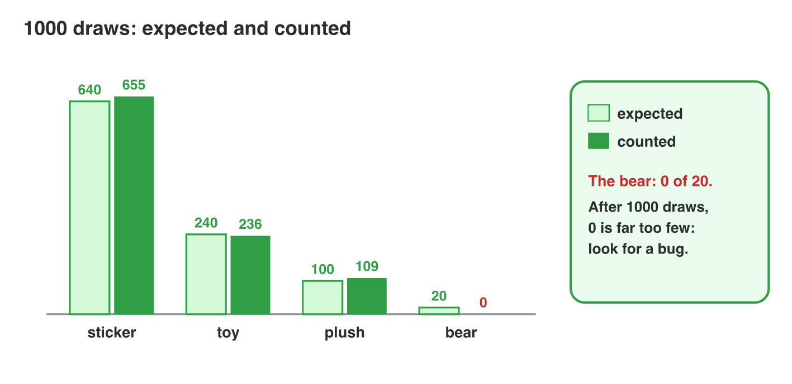

::: {.lead}
Today there are no new ideas. You use what Lecture 15 taught (an LCG step,
seeds, random calls, uniform chances and weighted choice) on the random
events of one fairground game, *Firefly Fair*: you run its generator by
hand, write its random calls, find uniform chances, build its prize table
and find a bug from the counts. Do each activity alone. The results of the
activities are at the end of this worksheet: try first, then compare.
:::

## Recall

- An LCG step: x(n+1) = (a·x(n) + c) mod m. The same seed gives the same
  numbers; seed once.
- `Random.Range(min, max)` with integers gives min … max − 1;
  `Random.value < p` is a yes with probability p.
- Uniform: every value 1/n; in a range, the chance of a part is its share of
  the length.
- Weighted: P(i) = wᵢ ÷ the sum; pick with cumulative weights and r < cumulative.

::: {.callout-tip title="Try it 1 · Recall"}
Choose the right answer.

::: {.match extra="1 … 6|1/2"}
Which numbers does `Random.Range(1, 6)` give?
:   1 … 5

    Why: the integer max is not included.

Weights 3 and 1. What is P(the second)?
:   1/4

    Why: 1 ÷ (3 + 1).

What is 17 mod 5?
:   2

    Why: 17 = 3 × 5 + 2.
:::
:::

## Activity 1 · A generator by hand

*Firefly Fair* is a small fairground game: moles pop up from holes, a
golden mole sometimes comes, and a prize booth gives prizes. Its test build
uses a tiny LCG with a = 3, c = 5, m = 16 and the seed 1.

{width=86%}

::: {.callout-note title="Activity 1 · Four numbers · 10 min"}
1. Compute the next four numbers after the seed 1.
2. Two testers both use the seed 1. Do they see the same moles? Why?
3. The code seeds the generator with the time in every frame. What do the
   testers see?

*Your product:* four numbers and two short answers.

::: {.check}
1. 3·1 + 5 = 8 → **8**; 3·8 + 5 = 29 → **13**; 3·13 + 5 = 44 → **12**;
   3·12 + 5 = 41 → **9**. 2. Yes: the same seed gives the same sequence.
3. In one frame the time, and so the seed, is the same: the same number
   comes again and again (for example every mole in the same hole). Seed
   once.
:::
:::

::: {.callout-tip title="Try it 2 · By hand"}
a = 3, c = 5, m = 16. Choose the right answer.

::: {.match extra="15|0"}
Which number follows 2?
:   11

    Why: 3·2 + 5 = 11, and 11 mod 16 = 11.

Which number follows 6?
:   7

    Why: 3·6 + 5 = 23, and 23 mod 16 = 7.

What is the longest possible period with m = 16?
:   16

    Why: only the values 0 … 15 exist.
:::
:::

## Activity 2 · The random calls of the game

The designer writes the random events of *Firefly Fair* in words.

{width=86%}

::: {.callout-note title="Activity 2 · Write the calls · 10 min"}
Write one call or condition for each event.

1. A mole pops up in one of the holes 0 … 8.
2. A golden mole comes with the probability 0.05.
3. A mole waits between 1 and 3 seconds (a float).
4. The code `Random.Range(1, 9)` should give the holes 1 … 9. Which hole
   never gets a mole? Write the fix.

*Your product:* three calls and one fix.

::: {.check}
1. `Random.Range(0, 9)`. 2. `Random.value < 0.05f`. 3.
`1 + Random.value * 2`. 4. Hole **9** never comes: the max is not
included. Fix: `Random.Range(1, 10)`.
:::
:::

::: {.callout-tip title="Try it 3 · Calls"}
Choose the call.

::: {.match extra="Random.Range(1, 9)|Random.value > 0.05f"}
A mole in one of the holes 0 … 8.
:   Random.Range(0, 9)

    Why: 9 values, the max 9 is not included.

A golden mole with the probability 0.05.
:   Random.value < 0.05f

    Why: below 0.05 in 5 % of the cases.

A hole 1 … 9.
:   Random.Range(1, 10)

    Why: the max must be one more than the last hole.
:::
:::

## Activity 3 · Uniform chances

The holes 0 … 8 are equally likely, and a mole waits a uniform time from 1
to 3 seconds.

{width=86%}

::: {.callout-note title="Activity 3 · How likely? · 10 min"}
1. What is P(the mole is in hole 4)?
2. What is P(the mole waits less than 1.5 s)?
3. A player sees 200 moles. About how many golden moles (p = 0.05)?

*Your product:* three numbers with one line of working each.

::: {.check}
1. 1/9 (9 equal holes). 2. From 1 to 1.5 s is 0.5 s of the 2-second range:
0.5/2 = **1/4**. 3. 200 × 0.05 = **10**.
:::
:::

::: {.callout-tip title="Try it 4 · Uniform"}
Choose the probability or the number.

::: {.match extra="1/8|5"}
P(the mole is in one of the holes 0, 1 or 2)?
:   1/3

    Why: 3 of 9 equal holes.

P(the wait is from 2 to 3 s), uniform from 1 to 3?
:   1/2

    Why: 1 s of the 2-second range.

About how many golden moles in 400 moles, p = 0.05?
:   20

    Why: 400 × 0.05.
:::
:::

## Activity 4 · A weighted prize table

The prize booth gives a sticker, a toy, a plush or a giant bear. The
weights are **64, 24, 10 and 2** (sum 100).

{width=86%}



::: {.callout-note title="Activity 4 · The prize table · 12 min"}
Use the four rows of **Loot Table Lab** for sticker, toy, plush and bear.

1. Write the cumulative weights. Which prize does r = 90 give?
2. Set the weights 64, 24, 10, 2 and open 1000. Are the counts close to the
   expected 640, 240, 100 and 20?
3. The owner wants the bear in 1 % of the draws and the plush in 11 %,
   with the sum still 100. Write new weights.

*Your product:* the cumulative weights, one prize, your counts and new
weights.

::: {.check}
1. 64, 88, 98, 100; r = 90 is from 88 to 98: the **plush**. 2. The counts
are close, but not exact (for example 652, 231, 98, 19). 3. For example
**64, 24, 11, 1**.
:::
:::

::: {.callout-tip title="Try it 5 · The prize table"}
Weights sticker 64, toy 24, plush 10, bear 2. Choose the right answer.

::: {.match extra="toy|10 %"}
What is P(toy)?
:   24 %

    Why: 24 ÷ 100.

r = 98.5 with cumulative 64, 88, 98, 100. Which prize?
:   bear

    Why: 98.5 is from 98 to 100.

r = 10 with cumulative 64, 88, 98, 100. Which prize?
:   sticker

    Why: 10 is below 64.
:::
:::

## Activity 5 · Find the bug from the counts

A tester draws 1000 prizes and counts: sticker 655, toy 236, plush 109,
bear **0**. The code is `float r = Random.value * 98;`, followed by the
usual check with r < cumulative.

{width=86%}

::: {.callout-note title="Activity 5 · The missing bear · 10 min"}
1. How many bears did the tester expect in 1000 draws?
2. Why does the code never give a bear?
3. Write the fix.

*Your product:* one number, one reason and one line of code.

::: {.check}
1. About 20 (2 % of 1000): 0 is far too few after 1000 draws. 2. r is
always below 98, but the bear needs r from 98 to 100. 3.
`float r = Random.value * 100;` (the sum of the weights).
:::
:::

::: {.callout-tip title="Try it 6 · Counts"}
Choose the right answer.

::: {.match extra="a bug for sure|1"}
The bear came 0 times in 20 draws. Is that a bug?
:   not yet, 20 draws are too few

    Why: with p = 0.02, 0 bears in 20 draws is very common.

The bear came 0 times in 1000 draws. Expected?
:   about 20

    Why: 1000 × 0.02.

`Random.value * 98` with a sum of 100. Which prize can never come?
:   the bear

    Why: r never reaches 98, where the bear starts.
:::
:::

::: {.callout-note .ai-task title="Task with AI · Simulate 1000 prize draws"}
**Goal:** a spreadsheet that draws 1000 prizes from the table 64, 24, 10, 2
and compares the counts with the expected numbers. By hand it takes hours;
with an AI assistant it takes minutes, and you check it.

1. **Ask the AI:** start with this prompt.

   ::: {.prompt}
   I use a spreadsheet (Excel or Google Sheets). Write formulas that draw one
   prize per row from this weighted table: sticker 64, toy 24, plush 10,
   bear 2. Use a random number from 0 to 100 and the cumulative weights.
   Then write formulas that count each prize in 1000 rows.
   :::

2. **Do it yourself:** paste the formulas, fill 1000 rows and read the four
   counts.
3. **Check:** work out the expected counts by hand (1000 × 64 % = 640, …).
   Your counts must be close. Check that a random number of exactly 64 gives
   a toy, not a sticker (r < cumulative). If the bear never comes, look at
   the range of the random number.

*Your product:* the sheet, the four counts next to the expected ones, and
one sentence on what the AI got wrong or what you changed.

::: {.check}
A good sheet: 1000 rows; counts close to 640, 240, 100 and 20 (for example
the bear 12 to 30); the borders use `<` (64 gives a toy). AI formulas often
use `<=` at the borders, a random number from 0 to 1 against weights up to
100, or count with the wrong range: look for all three.
:::
:::

## Case study: Loot Forge

The loot designer of *Torch Hall* has six questions. A chest has the loot
table common 50, rare 35, epic 12, legendary 3 (cumulative 50, 85, 97, 100).
A rack holds a bow with weight 2 and an axe with weight 3. A critical hit
comes with 15 %. The daily cave uses the date as the seed, and one item has
the weight 0. The Game challenge of the interactive page asks harder
questions about the forge: an r exactly on a border, the legendary items in
500 chests, a new mythic item, the seed of a given day and the critical
hits in 40 hits.



## Exercises

1. With a = 3, c = 5, m = 16, which number follows 9?
2. A game seeds its generator once with the number a player types. Why can
   two friends then play the same level?
3. Write the call for a lane 0 … 4.
4. Write the condition for a dodge with the probability 0.25.
5. A mole waits a uniform time from 2 to 6 seconds. P(it waits more than
   5 s)?
6. Weights 45, 30, 20, 5. Write the cumulative weights. Which item does
   r = 77 give?
7. In 1000 draws with the weights of exercise 6, about how many of the last
   item?
8. The code is `Random.Range(0, items.Length - 1)`. Which item never drops?

## Answers to the exercises

::: {.answers}
1. 3·9 + 5 = 32, and 32 mod 16 = 0.
2. The same seed gives the same numbers, and so the same level.
3. `Random.Range(0, 5)`.
4. `Random.value < 0.25f`.
5. 1 s of the 4-second range: 1/4.
6. 45, 75, 95, 100; r = 77 gives the third item (75 ≤ 77 < 95).
7. About 50 (5 % of 1000).
8. The last item: the max `items.Length - 1` is not included.
:::
