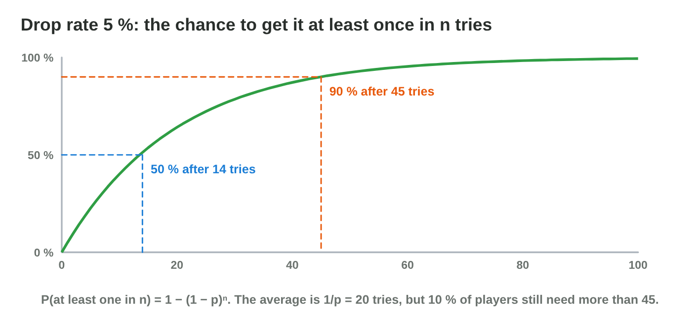

This page is the interactive version of the lesson notes (PDF). Each section
starts with a problem in a game. Then it explains the idea behind it. It ends
with a **Do it** task and one set of questions. Every question on this page
has its answer: try first, then check.

## Key terms



## 16.1 Drop rates and "at least once"

- **P(at least one in n) = 1 − (1 − p)ⁿ**: the complement of "none".
- p = 5 %: about 50 % after 14 tries, 90 % after 45 (read the figure).
- The average is 1/p, but some players wait much longer.

{width=94%}

::: {.callout-warning title="Watch out!"}
5 % × 20 is not 100 %: chances of tries do not add up.
:::

::: {.callout-note title="Do it · Chances of a drop"}
p = 0.5: compute the chance to have the item after 1, 2 and 3 tries.

::: {.check}
1/2; 1 − 1/4 = 3/4; 1 − 1/8 = 7/8. It grows, but never reaches 1.
:::
:::

::: {.callout-tip title="Try it 1 · At least once"}
Choose the probability.

::: {.match extra="100 %|20 %"}
p = 0.1, two tries. What is P(none)?
:   0.81

    Why: 0.9 × 0.9: the tries are independent.

p = 0.1, two tries. What is P(at least one)?
:   0.19

    Why: 1 − 0.81, the complement of none.

p = 5 %. About what is P(at least one in 45 tries)? Use the figure.
:   about 90 %

    Why: the curve reaches 90 % at 45 tries.

p = 0.25. How many tries on average?
:   4

    Why: 1/p = 1 ÷ 0.25.
:::
:::

## 16.2 Pity timers

- A **pity timer** guarantees the item after N misses, or raises the chance.
- The longest wait is limited; the average falls a little.
- Torch 5 % with a guarantee at 40: nobody waits more than 40 bats.

{width=94%}

::: {.callout-warning title="Watch out!"}
Be honest about drop chances; stores ask for shown odds on paid random items.
:::

::: {.callout-note title="Do it · Pity"}
Read the pity timer in the figure: after how many misses does the chance
start to grow? At which try is the item certain? What is the longest wait?

::: {.check}
After 20 misses (2 % per try before that); certain at try 40; so nobody
waits more than 40 tries.
:::
:::

::: {.callout-tip title="Try it 2 · Pity"}
Choose the right answer.

::: {.match extra="100|0"}
A pity timer guarantees the drop at try 25. The longest wait?
:   25

    Why: after 24 misses, try 25 always drops.

p = 5 %, no pity. The average number of tries?
:   20

    Why: 1/p = 1 ÷ 0.05.

What does a pity timer do to the average?
:   it falls a little

    Why: only the unlucky players get the item sooner.

Are the tries with a pity timer independent?
:   no

    Why: the chance depends on the misses before.
:::
:::

## 16.3 Rewards: expected value and the economy

- **E = Σ value × weight ÷ Σ weights.**
- Compare E with the shop prices: chests needed ≈ price ÷ E.
- 60 % 5 coins, 30 % 20, 10 % 60: E = 3 + 6 + 6 = 15; a 300-coin sword
  needs about 20 chests.

{width=94%}

::: {.callout-warning title="Watch out!"}
The plain average of the values overestimates the rewards.
:::

::: {.callout-note title="Do it · The economy"}
70 % 10 coins, 25 % 40 coins, 5 % 200 coins: E? Chests for a 270-coin
shield?

::: {.check}
E = 7 + 10 + 10 = 27 coins; 270 ÷ 27 = 10 chests.
:::
:::

::: {.callout-tip title="Try it 3 · Rewards"}
Choose the right answer. You can use an answer more than once.

::: {.match extra="28|85"}
A chest: 50 % 4 coins, 50 % 16 coins. E?
:   10

    Why: 2 + 8.

E = 10 coins. Chests for a 100-coin hat?
:   10

    Why: price ÷ E = 100 ÷ 10.

A chest: 90 % 10 coins, 10 % 100 coins. E?
:   19

    Why: 9 + 10.

In the chest 60 % 5, 30 % 20, 10 % 60, epic becomes 90 coins. The new E?
:   18

    Why: 3 + 6 + 0.1 × 90 = 3 + 6 + 9.
:::
:::

## 16.4 Real randomness is streaky

- k equal results **at one given place**: p^k^.
- In a long sequence, **some** long streak is very likely.
- 100 fair flips: the longest run is about 7.

{width=94%}



::: {.callout-warning title="Watch out!"}
One streak does not prove an unfair coin: look at many tries.
:::

::: {.callout-note title="Do it · Streaks"}
Write 50 "random" H and T by hand; find your longest run. Then run Streak
Lab at 50 % five times and compare.

::: {.check}
Most people write runs of 2 or 3. The computer runs are usually 5 to 8:
real randomness is streakier than it feels.
:::
:::

::: {.callout-tip title="Try it 4 · Streaks"}
Use Streak Lab. Choose the right answer.

::: {.match extra="0 %|100 %"}
Hit chance 0.7. P(3 misses at one place)?
:   0.3³ = 2.7 %

    Why: three independent misses: 0.3 × 0.3 × 0.3.

Hit chance 0.5. P(2 misses at one place)?
:   25 %

    Why: 0.5 × 0.5.

What is the usual longest run in 100 fair flips?
:   about 7

    Why: in 100 flips there are many places for a run to start.

A run of 5 tails in 100 flips. Is the coin unfair?
:   no, it is normal

    Why: a run of 5 or more comes in most sequences of 100.
:::
:::

## 16.5 The gambler's fallacy and the hot hand

- Independent events: P(A | the past) = P(A).
- **Gambler's fallacy:** "heads is due". **Hot hand:** "I hit, so I will
  hit again".
- P(TTTTH) = 1/32, but P(H | TTTT) = 1/2.

{width=94%}

::: {.callout-warning title="Watch out!"}
"If the player missed, roll again" changes the real chance.
:::

::: {.callout-note title="Do it · Due or not?"}
After 3 misses at 70 %, is a hit sure? Is P(3 misses) under 3 %? Is a crit
after a crit more likely?

::: {.check}
No: the next hit is still 0.7. Yes: 0.027. No: the hot-hand fallacy; the
chance is the same.
:::
:::

::: {.callout-tip title="Try it 5 · Fallacies"}
Choose the right answer.

::: {.match extra="0|1"}
A die showed no 6 in 4 rolls. P(6 on the next roll)?
:   1/6

    Why: the die has no memory.

What is P(TTH) for a fair coin?
:   1/8

    Why: the whole sequence: 1/2 × 1/2 × 1/2.

"A 6 is due after many rolls without one." Which mistake?
:   the gambler's fallacy

    Why: it expects the past to change the next roll.

"I scored twice, so I will score again." Which mistake?
:   the hot-hand fallacy

    Why: it expects luck to continue in independent tries.
:::
:::

## 16.6 How players feel probabilities

- High chances feel **sure**; bad streaks are remembered.
- P(at least one miss in n) = 1 − p^n^.
- 90 % and 10 attacks: a miss in about 65 % of the fights (figure).

{width=94%}

::: {.callout-warning title="Watch out!"}
If a fair rule feels unfair, the rule or the way you show it needs work.
:::

::: {.callout-note title="Do it · Feel the chance"}
Hit chance 90 %: P(at least one miss) in 2 attacks by hand; then read 5 and
20 attacks in the figure.

::: {.check}
1 − 0.81 = 0.19; 41 %; 88 %. A miss is very likely in a long fight.
:::
:::

::: {.callout-tip title="Try it 6 · At least one miss"}
Use the figure. Choose the right answer.

::: {.match extra="0.9|99 %"}
Hit chance 0.95, 10 attacks. P(at least one miss)?
:   about 40 %

    Why: the table: 95 % hit, 10 tries.

Hit chance 0.7, 5 attacks. P(at least one miss)?
:   about 83 %

    Why: the table: 70 % hit, 5 tries.

Hit chance 0.8, 2 attacks. P(at least one miss)?
:   0.36

    Why: 1 − 0.8 × 0.8 = 1 − 0.64.

A player misses at 90 % and says "bug!". What is true?
:   a miss is normal in a long fight

    Why: over many attacks, at least one miss is likely.
:::
:::

## 16.7 Shuffle bags

- A fixed set of results, shuffled, drawn **without putting back**; refill
  when empty.
- Exact share per bag; longest drought with 1 crit in n: **2(n − 1)**.
- Bag of 4 with 1 crit: exactly 25 crits in 100 attacks; at most 6 normal
  hits between two crits.

{width=94%}



::: {.callout-warning title="Watch out!"}
Small bags are predictable; big bags allow longer droughts.
:::

::: {.callout-note title="Do it · Bags"}
In **Bag Lab**, compare pure random and the shuffle bag over 1000 players.
Then compute the longest drought for 2 crits in a bag of 8.

::: {.check}
Both near 25 % crits; the worst drought is much longer with pure random
(often 20 or more) than with the bag (6). Bag of 8, 2 crits: 6 + 6 = 12.
:::
:::

::: {.callout-tip title="Try it 7 · Bags"}
Use Bag Lab. Choose the right answer.

::: {.match extra="25|no limit"}
A bag of 10 with 1 crit. Crits in 100 attacks?
:   exactly 10

    Why: every full bag has exactly one crit.

A bag of 3 with 1 crit. The longest drought?
:   4

    Why: 2(3 − 1): the crit first in one bag, last in the next.

A bag of 6 with 1 crit. The longest drought?
:   10

    Why: 2(6 − 1).

Are the draws of a shuffle bag independent?
:   no, on purpose

    Why: a drawn result does not go back into the bag.
:::
:::

## Game challenge: Fair or Frustrating? {.challenge}

Work alone. Use every section of today.

The *Torch Hall* team reads six messages. A player hits with **80 %** and
missed **two times in a row**. Another rolled **no 6 in five rolls** and
thinks a 6 is "due". A third hits with **70 %** and attacks **two times**. A
key drops with **50 %**, and a player tried **three times**. Crits come with
**20 %**, and the team tries a **shuffle bag with 1 crit and 4 normal
hits**. A chest gives **10 coins (80 %) or 50 coins (20 %)**, and a bow
costs **180 coins**.



::: {.callout-tip title="Try it 8 · The messages"}
Hit 80 %; no 6 in 5 rolls; key 50 %, 3 tries; bag 1 crit + 4 normal; chest
10 (80 %) or 50 (20 %), bow 180. Choose the right answer.

::: {.match extra="16 %|1"}
P(2 misses in a row at one place), hit 80 %?
:   4 %

    Why: 0.2 × 0.2.

P(a 6 on the next roll)?
:   1/6

    Why: the die has no memory.

P(at least one key in 3 tries)?
:   7/8

    Why: 1 − (1/2)³.

The longest wait without a crit with the bag?
:   8 attacks

    Why: 2(5 − 1).

Chests on average for the bow?
:   10

    Why: E = 8 + 10 = 18; 180 ÷ 18.
:::
:::

::: {.callout-tip title="Try it 9 · Tune the team's fixes (harder)"}
The same game. Choose the right answer.

::: {.match extra="2 times|always 20 %"}
The bag becomes 2 crits and 8 normal hits. The crit rate?
:   20 %, the same

    Why: 2 of 10 is still 20 %.

The bag of 2 crits in 10. The longest drought?
:   16 attacks

    Why: both crits first in one bag and last in the next: 8 + 8.

The bow price rises to 270 coins. Chests on average?
:   15

    Why: 270 ÷ 18.

The key gets a pity timer at try 4. P(no key after 4 tries)?
:   0

    Why: the timer guarantees the key at try 4.
:::
:::

## Summary {.summary}

- P(at least one in n) = 1 − (1 − p)ⁿ; the average is 1/p, but some players wait much longer.
- A pity timer limits the longest wait.
- Compare the expected reward with the prices of the shop.
- Real randomness has long streaks, and the past does not change the next try.
- Players feel high chances as sure; a shuffle bag gives exact shares and short droughts.
