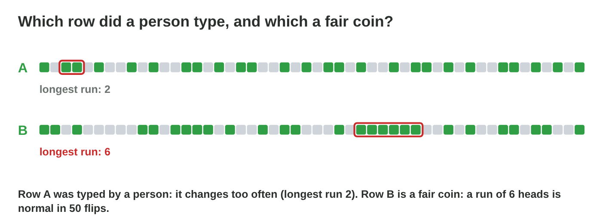
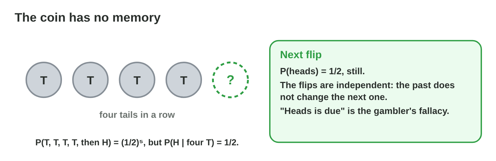
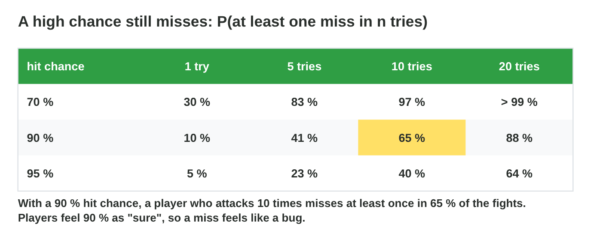
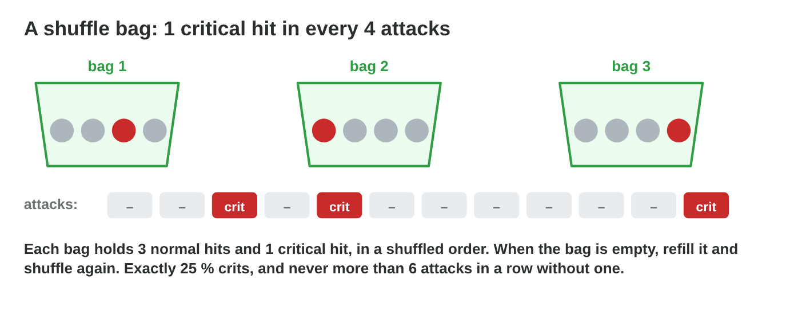
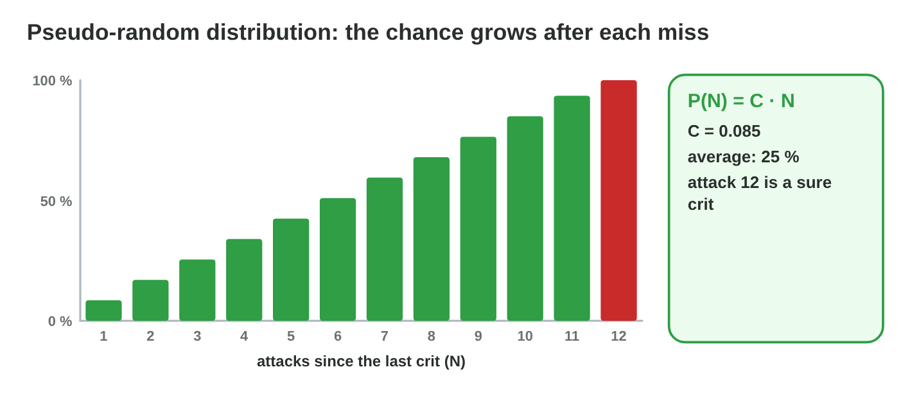
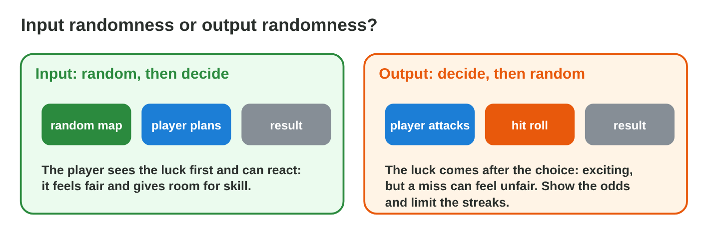

## Keywords



## 25.1 Real randomness is streaky

:::: {.columns}
::: {.column width="50%"}
- People expect random results to change often.
- Real randomness has long streaks.
- In 100 fair flips, the longest run is about 7.
- **Do it:** Write 50 random H and T by hand. How long is your longest run?
:::
::: {.column width="50%"}

:::
::::

## Live demo · Streak Lab



## Example · Three misses in a row

The guard hits with 70 %, and a player misses three times in a row.
**Is the game cheating?**

::: {.reveal}
1. At one given place: 0.3³ = **0.027**, about 2.7 %.
2. A fight of 100 attacks has almost 100 places to start a run.
3. A run of 4 or more misses happens in about **43 %** of the fights.
:::

## Try it 1 · Streaks

a) What is P(3 misses at one place) with hit chance 0.8?
b) In what share of 100-flip sequences is there a run of 5 or more?
c) Why does one streak not prove an unfair coin?

::: {.answer}
a) 0.2³ = 0.008
b) about 97 %
c) Long runs are normal in long sequences.
:::

## 25.2 The gambler's fallacy

:::: {.columns}
::: {.column width="50%"}
- Independent tries have no memory.
- "Heads is due" is the gambler's fallacy.
- P(TTTTH) = 1/32, but P(H | TTTT) = 1/2.
- **Do it:** Decide if a hit is sure after 3 misses at 70 %. Why or why not?
:::
::: {.column width="50%"}

:::
::::

## Example · Two golden torches

The torch drops with p = 0.05, and a player gets it from two bats in a row.
**Is the drop broken?**

::: {.reveal}
1. Two in a row at one place: 0.05² = **0.0025**.
2. With 10,000 players, this happens to **many players** every day.
3. The next bat still has **p = 0.05**, because the code has no memory.
:::

## Try it 2 · Fallacies

a) What is P(heads) after four tails?
b) What is P(TTTTH) for a fair coin?
c) What is the name of "I hit twice, so I will hit again"?

::: {.answer}
a) 1/2
b) 1/32
c) the hot-hand fallacy
:::

## 25.3 How players feel chances

:::: {.columns}
::: {.column width="50%"}
- A high chance feels sure, so a miss feels like a bug.
- Players remember the bad streaks.
- P(at least one miss in n) = 1 − p^n^.
- **Do it:** Compute P(at least one miss in 10) at 95 %. What do you get?
:::
::: {.column width="50%"}

:::
::::

## Example · The 90 % miss

A player attacks 10 times per fight with a hit chance of 90 %.
**How often does the player see a miss?**

::: {.reveal}
1. P(no miss) = 0.9¹⁰ ≈ **0.35**.
2. P(at least one miss) ≈ **0.65**.
3. In two of three fights the player sees a "90 % miss".
:::

## Try it 3 · At least one miss

a) What is P(at least one miss in 5) at p = 0.9?
b) What is P(at least one miss in 10) at p = 0.95?
c) What is P(at least one miss in 5) at p = 0.7?

::: {.answer}
a) about 41 %
b) about 40 %
c) about 83 %
:::

## 25.4 Shuffle bags

:::: {.columns}
::: {.column width="50%"}
- A bag holds a fixed set of results in a shuffled order.
- We draw without putting back and refill an empty bag.
- With 1 crit in a bag of n, the drought is at most 2(n − 1).
- **Do it:** Compare pure random and the bag in Bag Lab. Which has the longer droughts?
:::
::: {.column width="50%"}

:::
::::

## Live demo · Bag Lab



## Example · The crit bag

A bag of 4 holds 1 crit and 3 normal hits.
**How many crits come in 100 attacks, and how long can a drought be?**

::: {.reveal}
1. Every bag has one crit, so 100 attacks give exactly **25 crits**.
2. The worst case is a crit first in one bag and last in the next: **6** attacks.
3. Pure random 25 % has a drought of 12 or more in about **half** of the fights.
:::

## Try it 4 · Bags

a) What is the longest drought for 1 crit in a bag of 5?
b) What is the longest drought for 2 crits in a bag of 8?
c) Why are the draws from a bag not independent?

::: {.answer}
a) 8
b) 12
c) Each draw changes what is left in the bag.
:::

## 25.5 Pseudo-random distribution

:::: {.columns}
::: {.column width="50%"}
- The chance is C times the attacks since the last crit.
- C ≈ 0.085 gives an average of 25 %.
- A crit is sure as soon as C times N reaches 1.
- **Do it:** Compute P(N) for N = 1, 4 and 8 with C = 0.085. What are they?
:::
::: {.column width="50%"}

:::
::::

## Example · PRD for 25 %

The team uses PRD with C = 0.085 for the crits.
**How does the chance grow?**

::: {.reveal}
1. The first attack after a crit has **8.5 %**, and the fifth has **42.5 %**.
2. The twelfth has 12 × 0.085 = 1.02, so it is a **sure crit**.
3. The average is still about **25 %**, with no long droughts.
:::

## Try it 5 · PRD

a) What is P(8) with C = 0.085?
b) At which attack is a crit sure when C = 0.2?
c) Why does C = 0.25 not give an average of 25 %?

::: {.answer}
a) 68 %
b) the 5th
c) The chance grows too fast after each miss.
:::

## 25.6 Input or output randomness

:::: {.columns}
::: {.column width="50%"}
- Input randomness comes before the decision, like a random map.
- Output randomness comes after it, like a hit roll.
- The shown odds must be the real odds.
- **Do it:** Sort five random events into input and output. Which list is longer?
:::
::: {.column width="50%"}

:::
::::

## Game challenge · Fair or Frustrating?



## Try it 6 · Compute (harder)

a) What is 1 − 0.9⁵?
b) What is P(6) for PRD with C = 0.085?
c) Is the weather shown before a race input or output randomness?

::: {.answer}
a) about 0.41
b) 0.51
c) input randomness
:::

## Summary

- Real randomness is streaky, and one streak proves nothing.
- Independent tries have no memory.
- Players feel high chances as sure.
- Shuffle bags and PRD keep the rate and limit droughts.
- Input randomness and honest odds make a game feel fair.
