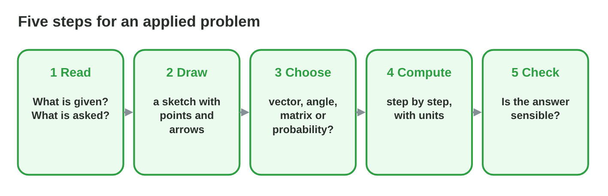
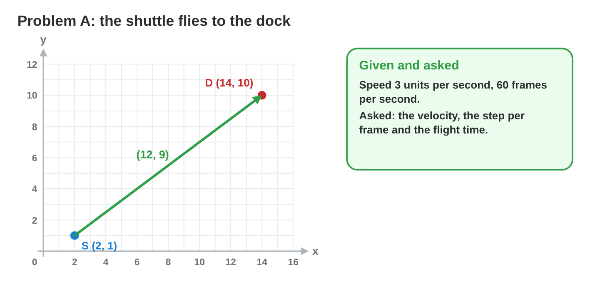
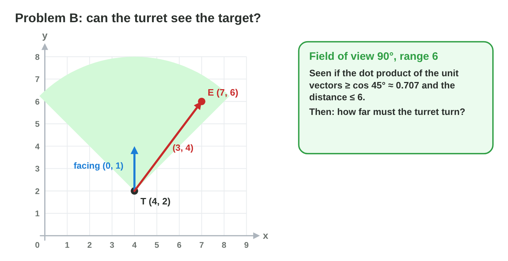
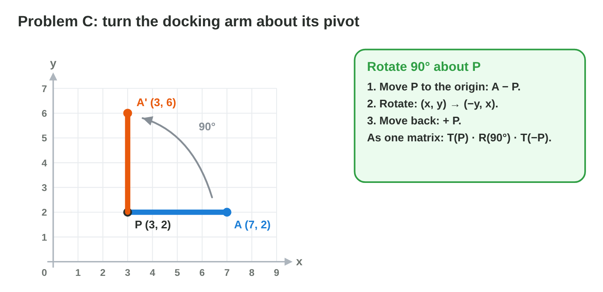
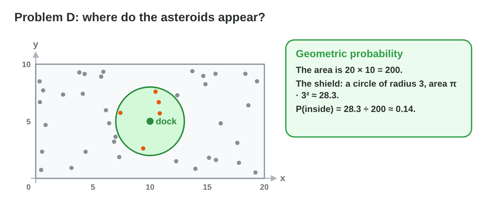

::: {.lead}
The space game *Star Dock* is almost finished. The control room still has a
list of problems: how fast must the shuttle fly, can the turret see an
enemy, where is the tip of the docking arm after it turns, and how often do
asteroids appear inside the shield? None of these problems says "use the
dot product" or "use a matrix". You have to **find** the right tool. In
this course you learned vectors (lectures 2–6), angles (lectures 7–8),
matrices and transformations (lectures 9–14) and probability (lectures
20–25). This lesson is a **problem set**: every section is one applied
problem, solved step by step, followed by a similar problem for you. Every
section ends with a short task.
:::

## Key terms



## 26.1 Five steps for an applied problem

Good problem solvers do not start computing at once. They follow a plan
(@fig-steps).

::: {.callout-important title="Definition 26.1 — Five steps"}
1. **Read:** write down what is given (points, speeds, chances) and what is
   asked.
2. **Draw:** a sketch with the points, the arrows and the angles.
3. **Choose the tool:** a step between points → a vector; "can it see" or
   "how far to turn" → the dot product or atan2; "turn or grow about a
   point" → a transformation about a pivot; "how often" → probability.
4. **Compute:** step by step, with units (seconds, degrees, units).
5. **Check:** Is the answer sensible? A probability is between 0 and 1; a
   length is positive; a turn of 300° is probably a turn of −60°.
:::

{#fig-steps width=94%}

::: {.callout-note title="Example 26.1 — The cargo drone"}
A cargo drone at (1, 1) must reach a crate at (4, 5) in 2 seconds.

1. *Read:* given two points and a time; asked: the speed.
2. *Draw:* an arrow from (1, 1) to (4, 5).
3. *Choose:* a vector (the step) and its length.
4. *Compute:* (4, 5) − (1, 1) = (3, 4); length 5; speed = 5 ÷ 2 =
   2.5 units per second.
5. *Check:* 2.5 units per second for 2 seconds is 5 units: correct.
:::

::: {.callout-warning title="Common mistake"}
Choosing a tool because of a word. "Angle" does not always mean sine and
cosine; "how far to turn" towards a target is often easiest with atan2 or
the dot product. Draw first, then choose.
:::

::: {.callout-note title="Do it · Plan, do not compute"}
For each problem of the list below, write only steps 1–3 (given, sketch,
tool): (a) how long a laser needs from (0, 0) to (30, 40) at 25 units per
second; (b) whether a guard facing (1, 0) sees a thief at (2, 5);
(c) how often a random point in a 10 × 10 square lands in a 2 × 3 box.

*Your result:* three plans.
:::

## 26.2 Problem A: the shuttle flies to the dock

Motion problems use the step vector, its length and the unit direction
(@fig-shuttle).

::: {.callout-important title="Key facts 26.2 — Motion"}
- Step: $\vec{d} = D - S$; distance: $|\vec{d}|$.
- Unit direction: $\hat{d} = \vec{d} / |\vec{d}|$; velocity:
  $\vec{v} = \text{speed} \cdot \hat{d}$.
- Step per frame: $\vec{v} \cdot \Delta t$ with $\Delta t = 1 / \text{fps}$;
  flight time: $|\vec{d}| / \text{speed}$.
:::

{#fig-shuttle width=94%}

::: {.callout-note title="Example 26.2 — The shuttle"}
The shuttle at $S = (2, 1)$ flies to the dock $D = (14, 10)$ at 3 units per
second; the game runs at 60 frames per second.

1. $\vec{d} = (14, 10) - (2, 1) = (12, 9)$; $|\vec{d}| = \sqrt{144 + 81} =
   \sqrt{225} = 15$.
2. $\hat{d} = (12, 9) / 15 = (0.8, 0.6)$; $\vec{v} = 3 \cdot (0.8, 0.6) =
   (2.4, 1.8)$.
3. Per frame: $(2.4, 1.8) / 60 = (0.04, 0.03)$.
4. Flight time: $15 / 3 = 5$ s, that is $5 \cdot 60 = 300$ frames.
5. *Check:* 300 frames × (0.04, 0.03) = (12, 9). Correct.
:::

::: {.callout-caution title="In game code"}
```csharp
Vector2 d = dock - shuttle;                 // (12, 9)
Vector2 v = d.normalized * speed;           // (2.4, 1.8)
shuttle += v * Time.deltaTime;              // every frame
```
:::

::: {.callout-warning title="Common mistake"}
Moving by $\vec{d}$ every frame: the shuttle jumps to the dock (and past it)
at once. Use the unit direction, the speed and $\Delta t$.
:::

::: {.callout-note title="Do it · Your shuttle"}
A rescue pod at (−3, 2) flies to (9, 7) at 2.6 units per second at 50 fps.
Find the distance, the velocity, the step per frame and the flight time.
Check your answer in **Problem Drill** (topic Vectors) with two more
problems.

*Your result:* four answers and two checked drill problems.
:::

## 26.3 Problem B: can the turret see the target?

"Can it see" and "how far to turn" need the dot product and atan2
(@fig-turret).

::: {.callout-important title="Key facts 26.3 — Seeing and turning"}
- Unit vector to the target: $\hat{u} = (E - T) / |E - T|$.
- **Inside a field of view** of angle $\alpha$: $\hat{f} \cdot \hat{u} \ge
  \cos(\alpha / 2)$, where $\hat{f}$ is the unit facing; **in range**:
  $|E - T| \le r$.
- **Turn angle:** $\operatorname{atan2}(u_y, u_x) -
  \operatorname{atan2}(f_y, f_x)$, then bring it into $-180°$ to $180°$.
:::

{#fig-turret width=94%}

::: {.callout-note title="Example 26.3 — The turret"}
The turret at $T = (4, 2)$ faces $\hat{f} = (0, 1)$, has a 90° field of view
and range 6. The target is at $E = (7, 6)$.

1. $E - T = (3, 4)$; distance 5; $\hat{u} = (0.6, 0.8)$.
2. $\hat{f} \cdot \hat{u} = 0 \cdot 0.6 + 1 \cdot 0.8 = 0.8 \ge \cos 45°
   \approx 0.707$: inside the field of view. $5 \le 6$: in range. **Seen.**
3. Turn: $\operatorname{atan2}(0.8, 0.6) \approx 53.1°$; the facing is at
   90°; turn $53.1° - 90° = -36.9°$ (clockwise).
4. *Check:* $\cos 36.9° \approx 0.8$, the same as the dot product.
:::

::: {.callout-warning title="Common mistake"}
Comparing the dot product with the whole field of view: for 90°, compare
with $\cos 45°$, not $\cos 90° = 0$ (that would be a 180° view).
:::

::: {.callout-note title="Do it · Your turret"}
A turret at (1, 1) faces (1, 0) with a 60° field of view and range 10. Is a
target at (9, 7) seen? How far must the turret turn to face it? Then solve
two problems in **Problem Drill** (topic Angles).

*Your result:* a decision with numbers, a turn angle and two checked
problems.
:::

## 26.4 Problem C: the docking arm

Turning or growing **about a point** needs three moves, or one composite
matrix (@fig-arm).

::: {.callout-important title="Key facts 26.4 — About a pivot"}
To rotate or scale a point $A$ about a pivot $P$:

1. Move $P$ to the origin: $A - P$.
2. Rotate or scale: for 90° counterclockwise, $(x, y) \to (-y, x)$; for a
   factor $k$, $(x, y) \to (kx, ky)$.
3. Move back: add $P$.

As one matrix in homogeneous coordinates: $M = T(P) \cdot R(\theta) \cdot
T(-P)$. The order matters (read it from right to left).
:::

{#fig-arm width=94%}

::: {.callout-note title="Example 26.4 — Turn, then grow"}
The arm turns 90° counterclockwise about $P = (3, 2)$; its tip is at
$A = (7, 2)$. Then the arm grows by the factor 1.5 about $P$.

1. $A - P = (4, 0)$; rotate: $(0, 4)$; $A' = (3, 2) + (0, 4) = (3, 6)$.
2. Grow: $A' - P = (0, 4)$; $1.5 \cdot (0, 4) = (0, 6)$; $A'' = (3, 8)$.
3. *Check:* the arm is 4 long before and $1.5 \cdot 4 = 6$ long after: the
   distance from $P$ to $A''$ is 6. Correct.
:::

::: {.callout-warning title="Common mistake"}
Rotating $A$ about the origin: $(7, 2) \to (-2, 7)$. The arm would leave its
pivot. Always subtract the pivot first.
:::

::: {.callout-note title="Do it · Your arm"}
A crane arm has its pivot at (−1, 2) and its tip at (2, 6). Rotate the tip
90° counterclockwise about the pivot, then scale it by 0.5 about the pivot.
Solve two problems in **Problem Drill** (topic Transformations).

*Your result:* two points and two checked problems.
:::

## 26.5 Problem D: asteroids and shots

Probability problems in games often come with a picture: an area, or a row
of shots (@fig-spawn).

::: {.callout-important title="Key facts 26.5 — Area and repeated tries"}
- **Geometric probability:** a random point, uniform in a region, falls
  into a part of it with probability $\dfrac{\text{area of the part}}{\text{area of the region}}$.
- **At least one** success in $n$ independent tries: $1 - (1 - p)^n$.
- **Expected number** of successes in $n$ tries: $n \cdot p$.
:::

{#fig-spawn width=94%}

::: {.callout-note title="Example 26.5 — The shield and the turret"}
Asteroids appear uniformly in a rectangle of $20 \times 10$. The dock's
shield is a circle of radius 3 inside it. The turret hits with $p = 0.6$ per
shot.

1. $P(\text{inside the shield}) = \pi \cdot 3^2 / 200 \approx 28.3 / 200
   \approx 0.14$.
2. Of 50 asteroids, about $50 \cdot 0.14 \approx 7$ appear inside the
   shield.
3. The turret fires 3 shots: $P(\text{at least one hit}) = 1 - 0.4^3 =
   0.936$; expected hits $3 \cdot 0.6 = 1.8$.
4. *Check:* 0.14 and 0.936 are between 0 and 1; 1.8 hits is between 0 and
   3.
:::

::: {.callout-warning title="Common mistake"}
Comparing lengths instead of areas: "radius 3 of height 10, so 0.3". The
probability of a region is a ratio of **areas**.
:::

::: {.callout-note title="Do it · Your probabilities"}
Enemies appear uniformly on a 30 × 20 map. A trap covers a 6 × 5 rectangle.
How often does an enemy appear on the trap? Of 40 enemies, how many on
average? Then solve two problems in **Problem Drill** (topic Probability).

*Your result:* two answers and two checked problems.
:::

## 26.6 Problem E: a mixed mission

Real problems mix the tools. Use the five steps for each part.

::: {.callout-important title="Key facts 26.6 — A mixed problem"}
Split the problem into parts. For each part, ask: Which tool? What is the
result? Which result does the next part need? Write the results of each
part clearly, so that a mistake in one part does not hide in the next.
:::



::: {.callout-note title="Example 26.6 — The mining drone"}
A mining drone waits at the dock $O = (0, 0)$, facing $(1, 0)$. An asteroid
is at $(6, 8)$. The drone flies at 2 units per second. Each asteroid holds a
crystal with $p = 0.25$.

1. *Vector:* the step is $(6, 8)$, length 10; flight time $10 / 2 = 5$ s.
2. *Angle:* $\cos\theta = (1, 0) \cdot (0.6, 0.8) = 0.6$, so $\theta
   \approx 53.1°$: the drone turns 53.1° counterclockwise.
3. *Transformation:* its drill tip, 1 unit in front of the drone, was at
   $(1, 0)$; the rotation matrix with $\cos\theta = 0.6$, $\sin\theta =
   0.8$ moves it to $(0.6, 0.8)$.
4. *Probability:* in 4 asteroids, $P(\text{at least one crystal}) = 1 -
   0.75^4 \approx 0.68$; in 20 asteroids, $20 \cdot 0.25 = 5$ crystals on
   average.
:::

::: {.callout-warning title="Common mistake"}
Rounding too early. If you round the direction to (0.6, 0.8) in a problem
where it is really (0.57, 0.82), every later part is a little wrong. Keep
two or three decimals until the end.
:::

::: {.callout-note title="Do it · Your mission"}
A drone at (2, 1), facing (0, 1), must fly to an asteroid at (−3, 13) at 2.6
units per second. Each asteroid holds a crystal with $p = 0.2$. Find the
flight time, the turn angle, and $P(\text{at least one crystal in 5
asteroids})$.

*Your result:* three answers with the steps.
:::

## Case study: Star Dock Missions

The control room of *Star Dock* sends six missions: the flight time of the
shuttle, its velocity, whether the turret can see a target, the new tip of
the docking arm, the chance that an asteroid appears inside the shield, and
the chance that the turret hits at least once. The Game challenge of the
interactive lesson uses these missions. In the mini-game below you choose
the right result for each one.



## Further reading

Dunn and Parberry, *3D Math Primer for Graphics and Game Development*, 2nd
ed. (2011), Chapters 2, 4 and 5 (vectors and transformations). Pólya, *How to
Solve It* (1945), the four phases of problem solving.

## Exercises

1. List the five steps for an applied problem.
2. A ship at (1, 2) sails to (9, 8) at 5 units per second. How long is the
   trip?
3. In exercise 2, what is the velocity?
4. At 50 fps, what is the step per frame in exercise 3?
5. A guard at (0, 0) faces (1, 0) with a 90° field of view. Is a thief at
   (3, 4) inside it?
6. In exercise 5, how far must the guard turn to face the thief?
7. Rotate (5, 1) by 90° counterclockwise about (2, 1).
8. Scale (5, 1) by the factor 2 about (2, 1).
9. Write the composite matrix for "rotate by θ about P" as a product of
   three matrices.
10. A random point in a 10 × 10 square. P(it lies in a circle of radius 2
    inside the square)?
11. A turret hits with p = 0.7. P(at least one hit in 2 shots)?
12. Expected hits in 10 shots with p = 0.7?
13. Why must a probability problem with a region compare areas, not lengths?
14. Why should you not round in the middle of a mixed problem?

## Answers to the exercises

::: {.answers}
1. Read, draw, choose the tool, compute, check.
2. Step (8, 6), length 10; 10 / 5 = 2 s.
3. 5 × (0.8, 0.6) = (4, 3).
4. (4, 3) / 50 = (0.08, 0.06).
5. Unit vector (0.6, 0.8); dot with (1, 0) = 0.6 < 0.707: not inside.
6. atan2(4, 3) ≈ 53.1°: turn 53.1° counterclockwise.
7. (5, 1) − (2, 1) = (3, 0) → (0, 3); + (2, 1) = (2, 4).
8. (3, 0) × 2 = (6, 0); + (2, 1) = (8, 1).
9. $T(P) \cdot R(\theta) \cdot T(-P)$.
10. $\pi \cdot 4 / 100 \approx 0.126$.
11. $1 - 0.3^2 = 0.91$.
12. 7.
13. A random point is spread over the whole region; the share of the region
    is a share of its area.
14. Small rounding errors grow in the later parts.
:::
