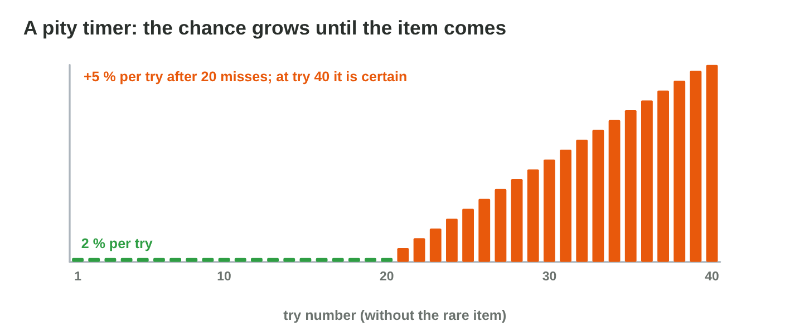
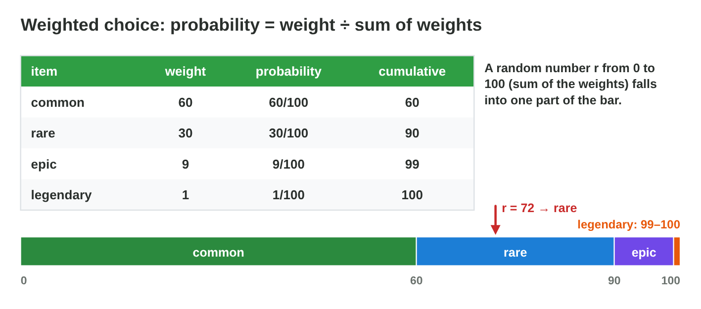
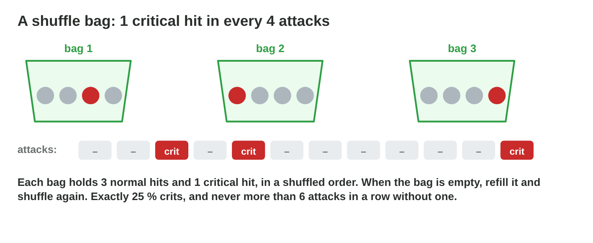

No new ideas today: three short problems on Lecture 12. Do each one alone.
Tap, sort or type your answer at every step: the page checks it at once and
tells you why.

## Recall

- P(at least one drop in n tries) = 1 − (1 − p)ⁿ; the average is 1/p
  tries. A pity timer limits the longest wait.
- The expected reward E = Σ value × probability; chests for an item ≈
  price ÷ E.
- Independent tries have no memory; a shuffle bag gives exact shares.

::: {.callout-tip title="Try it 1 · Recall"}
Choose the right answer.

::: {.match extra="2|100 %"}
p = 0.5. What is P(at least one drop in 2 tries)?
:   3/4

    Why: 1 − (1/2)² = 1 − 1/4 = 3/4.

p = 0.1. How many tries does a player need on average?
:   10

    Why: The average is 1/p = 10.

A chest gives 2 coins (50 %) or 8 coins (50 %). What is E?
:   5

    Why: 2 × 0.5 + 8 × 0.5 = 1 + 4 = 5.
:::
:::

## Activity 1 · The rare hammer

In *Mole Keep*, a rare hammer drops with **p = 2 %**. A formula gives the
average wait; a simulation also shows the unlucky players. **Drop Rate
Lab** lets 1000 players hunt the hammer.

{width=80%}



::: {.callout-note title="Activity 1 · Waits and a pity timer · 18 min"}
1. What is the average number of tries? Compute it, then check in the lab.
2. Simulate 1000 players without a pity timer. What is the longest wait?
3. Add a pity timer at 60. What are the average and the longest wait now?
   Would you keep the timer?

*Your product:* one computed and three simulated numbers, and one sentence.

::: {.fill answer="50" unit="tries" hint="The average wait is 1/p."}
Step 1: what is the average number of tries with p = 2 %?

Why: 1/0.02 = 50 tries.
:::

::: {.choice}
Step 2: without a pity timer, what is the longest wait of 1000 players?

- [x] often 200 tries or more

  Why: Some players are very unlucky: the wait has no limit.

- [ ] 50 tries

  Why: 50 is the average; many players wait longer.

- [ ] exactly 100 tries

  Why: Without a timer nothing stops the wait at 100.
:::

::: {.choice}
Step 3: with a pity timer at 60, what changes?

- [x] The average falls a little (about 40), and nobody waits more than 60.

  Why: The timer ends the endless waits but keeps the early lucky drops: keep it.

- [ ] Every player waits exactly 60 tries.

  Why: Lucky players still get the hammer early.

- [ ] The average rises to 60.

  Why: The timer only cuts the long waits, so the average falls.
:::
:::

::: {.callout-tip title="Try it 2 · Waits"}
Choose the right answer.

::: {.match extra="the average only|0"}
p = 4 %. What is the average number of tries?
:   25

    Why: 1/p = 1 ÷ 0.04 = 25.

A pity timer is set at 60. What is the longest wait?
:   60

    Why: Try 60 always gives the item.

What does a simulation show that the formula 1/p does not?
:   the unlucky players

    Why: It shows the whole spread of waits, not only the average.
:::
:::

## Activity 2 · The chest and its odds

A chest of *Mole Keep* gives **10 coins with 80 %** or **50 coins with
20 %**. A bow costs **180 coins**. The store page says "big prize: 30 %".

{width=80%}

::: {.callout-note title="Activity 2 · Reward and odds · 15 min"}
1. Compute the expected reward E of one chest.
2. About how many chests does a player open on average for the bow?
3. Is the store page honest? Write the odds that the chest screen must
   show.

*Your product:* two numbers, one answer and two odds.

::: {.fill answer="18" unit="coins" hint="10 × 0.8 + 50 × 0.2."}
Step 1: what is the expected reward E of one chest?

Why: 10 × 0.8 + 50 × 0.2 = 8 + 10 = 18 coins.
:::

::: {.fill answer="10" unit="chests" hint="The price of the bow ÷ E."}
Step 2: about how many chests does a player open for the bow (180 coins)?

Why: 180 ÷ 18 = 10 chests.
:::

::: {.choice}
Step 3: the store page says "big prize: 30 %". Is it honest?

- [x] No: the screen must show 10 coins: 80 %, 50 coins: 20 %.

  Why: The real chance of the big prize is 20 %, not 30 %.

- [ ] Yes: 30 % is close enough.

  Why: Shown odds must be the real odds.

- [ ] Yes: players like a bigger number.

  Why: Wrong odds mislead the players; stores ask for the real ones.
:::
:::

::: {.callout-tip title="Try it 3 · Rewards and odds"}
Choose the right answer.

::: {.match extra="25 %|5"}
A chest gives 4 coins (75 %) or 20 coins (25 %). What is E?
:   8

    Why: 4 × 0.75 + 20 × 0.25 = 3 + 5 = 8.

E is 8 coins, and a shield costs 80 coins. About how many chests for the shield?
:   10

    Why: 80 ÷ 8 = 10.

The code gives the big prize with 20 %, but the page says 30 %. What is this?
:   dishonest odds

    Why: Shown odds must be the real odds.
:::
:::

## Activity 3 · Streaks and a shuffle bag

Three players write to the team. Player 1 hits with **90 %** and missed
**two times in a row**: "the game cheats!". Player 2 flipped a coin in a
mini-game and got **four tails in a row**: "now heads must come!". Player 3
asks how often a crit comes: the crits come from a **shuffle bag with 1
crit and 3 normal hits**.

{width=80%}

::: {.callout-note title="Activity 3 · Answer the players · 18 min"}
1. What is the chance of two misses in a row with a hit chance of 90 %?
2. Is player 2 right? What is P(heads) on the next flip?
3. What share of the hits are crits? What is the longest run of normal
   hits without a crit?
4. Present your answer to player 1 alone: a reply of three sentences
   (what the player saw, the number, and what it means for the game).
   Read it aloud in less than one minute.

*Your product:* three short answers, each with a number, and the reply to
player 1.

::: {.fill answer="0.01|1%|1/100" hint="The miss chance is 0.1; two in a row: multiply."}
Step 1: what is the chance of two misses in a row at 90 %?

Why: 0.1 × 0.1 = 0.01 = 1 %: rare, but with many players it happens every day.
:::

::: {.choice}
Step 2: four tails in a row. Is player 2 right that heads must come?

- [x] No: P(heads) is still 1/2.

  Why: The coin has no memory; "heads is due" is the gambler's fallacy.

- [ ] Yes: after four tails, heads is due.

  Why: Each flip is independent: the past does not change it.
:::

::: {.choice}
Step 3: a shuffle bag with 1 crit and 3 normal hits. What share are crits,
and what is the longest run without a crit?

- [x] 25 %, and at most 6 normal hits

  Why: 1 of 4 hits; the crit can be first in one bag and last in the next: 3 + 3.

- [ ] 25 %, and at most 3 normal hits

  Why: Two bags in a row can put 3 + 3 normal hits between the crits.

- [ ] 33 %, and at most 3 normal hits

  Why: 1 crit in a bag of 4 is 1/4 = 25 %.
:::

::: {.choice}
Step 4: which reply to player 1 is good?

- [x] "Two misses in a row at 90 % have the chance 1 %. With thousands of players, this happens to someone every day. The game is fair: every shot still hits with 90 %."

  Why: It says what the player saw, gives the number and what it means.

- [ ] "The game is fair. Please play again."

  Why: It gives no number and does not explain what happened.

- [ ] "Two misses in a row at 90 % have the chance 10 %, so it is normal."

  Why: The number is wrong: 0.1 × 0.1 = 1 %.
:::
:::

::: {.callout-tip title="Try it 4 · Streaks and bags"}
Choose the right answer.

::: {.match extra="1/16|always 25 %"}
Hit chance 80 %. What is P(two misses in a row)?
:   4 %

    Why: 0.2 × 0.2 = 0.04.

A die showed no 6 in five rolls. What is P(a 6 on the next roll)?
:   1/6

    Why: The die has no memory.

A shuffle bag has 1 crit and 4 normal hits. What is the longest run without a crit?
:   8 normal hits

    Why: The crit is first in one bag and last in the next: 4 + 4.
:::
:::

## At home · Task with AI

::: {.callout-note .ai-task title="Task with AI · 1000 hunters in a chart"}
An extra for the curious: let an AI assistant draw it. Copy the prompt
into an AI assistant that the university allows (for example Microsoft
Copilot with your university account), and look at the picture.

::: {.prompt}
In a game, a rare hammer drops with the chance 2 % on each try. Simulate
1000 players: each player tries again and again until the hammer drops.
Draw a column chart of the number of tries in groups of 10 (1–10, 11–20,
and so on), and give the average number of tries and the largest number of
tries.
:::

::: {.choice}
What should the chart show? The AI can be wrong: compare.

- [x] The first column (1–10) is the tallest, about 180 players; the columns fall to the right; the average is near 50.

  Why: 1 − 0.98¹⁰ ≈ 18 % drop it early; the average is 1 ÷ 2 % = 50, and a few need over 200 tries.

- [ ] All columns are about the same height, around 50 tries.

  Why: Each try can drop the hammer, so early columns are the tallest.
:::

::: {.try-change}
**Change:** change the chance to 5 %, and ask again.

::: {.choice}
What changes?

- [x] The average is near 20, and the first column holds about 400 players.

  Why: 1 ÷ 5 % = 20, and the columns fall much faster.

- [ ] The average stays near 50.

  Why: A higher chance makes the waits shorter: 1 ÷ 5 % = 20.
:::
:::

::: {.try-change}
**Change:** change the chance to 50 %, and ask again.

::: {.choice}
What changes?

- [x] Almost every player gets the hammer in the first 10 tries; the average is near 2.

  Why: 1 ÷ 50 % = 2: one column holds nearly everyone.

- [ ] The chart looks the same as with 2 %.

  Why: The chance decides the waits: 50 % makes them very short.
:::
:::

**Your own idea:** change one more number or word, and look again. The AI
can be wrong: compare its result with the answers.
:::

## Wrap-up {.summary}

- You can balance the wait for a rare item with the average and a pity
  timer.
- You can compute the expected reward of a chest and check its odds.
- You can answer players about streaks and shuffle bags with numbers.
