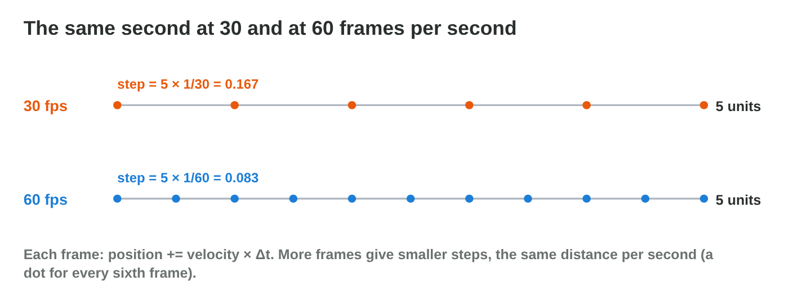
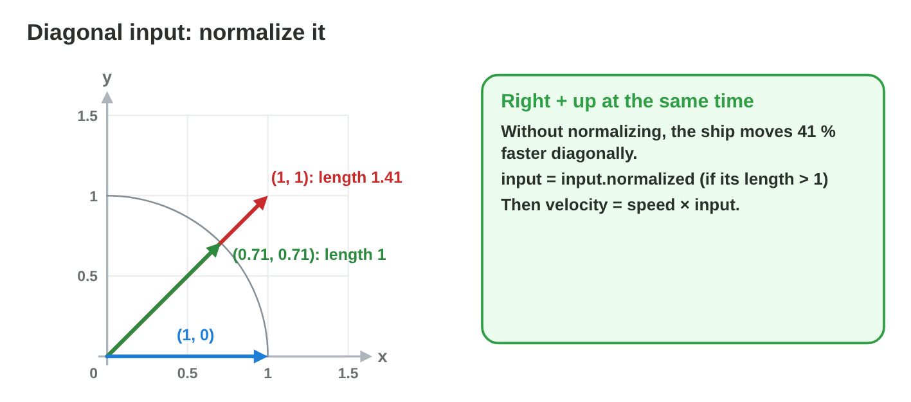
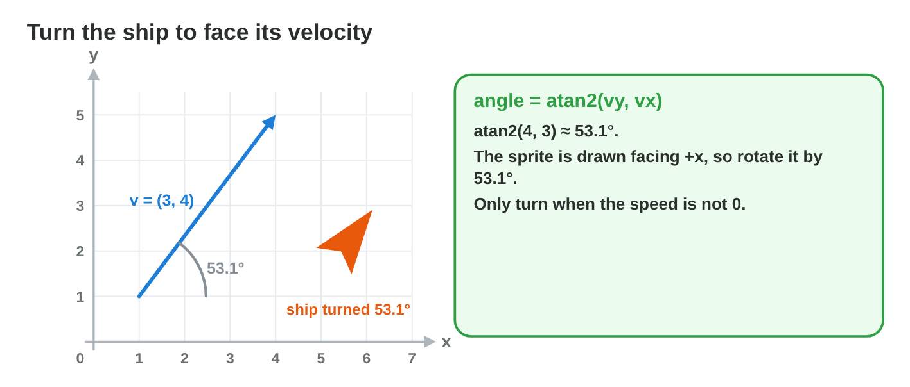
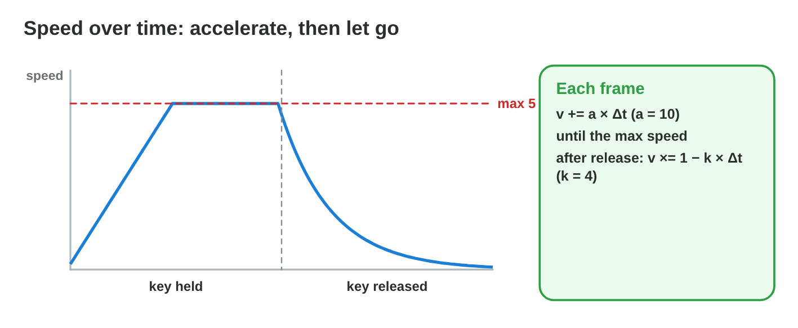
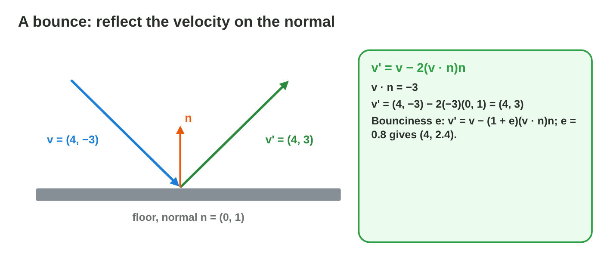
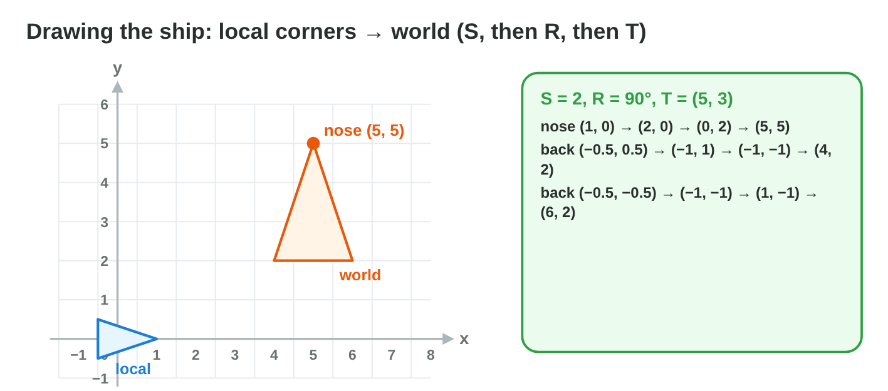

## Keywords



## 27.1 Motion per frame with Δt

:::: {.columns}
::: {.column width="50%"}
- Each frame adds velocity times Δt to the position.
- At 60 fps, Δt is 1/60 of a second.
- The distance per second is the same at every frame rate.
- **Do it:** Compute the step of a meteor at 12 units per second at 30 fps. What is it?
:::
::: {.column width="50%"}

:::
::::

## Example · 30 or 60 fps

The shuttle flies at 5 units per second to the right.
**How far does it fly in one second at 30 and at 60 fps?**

::: {.reveal}
1. At 60 fps each step is about **0.083**, and 60 steps give 5 units.
2. At 30 fps each step is about **0.167**, and 30 steps give 5 units.
3. Without Δt, the 30 fps laptop moves only **2.5** units per second.
:::

## Try it 1 · Steps

a) What is the step per frame at speed 9 and 30 fps?
b) What is the step per frame at speed 5 and 60 fps?
c) Why is a game without Δt slower on a slow computer?

::: {.answer}
a) 0.3
b) about 0.083
c) It has fewer frames, each with the same step.
:::

## 27.2 Input and diagonal movement

:::: {.columns}
::: {.column width="50%"}
- Right plus up gives the input (1, 1) with length 1.41.
- We normalize the input when its length is above 1.
- The velocity is the speed times the normalized input.
- **Do it:** Fly diagonally in Move Lab with and without normalizing. Which speeds do you see?
:::
::: {.column width="50%"}

:::
::::

## Live demo · Move Lab



## Try it 2 · Diagonals

a) What is the speed for input (1, 1) and speed 5 without normalizing?
b) What is (1, −1) after normalizing?
c) Why must we not normalize (0, 0)?

::: {.answer}
a) about 7.07
b) (0.71, −0.71)
c) It has length 0 and no direction.
:::

## 27.3 Facing the velocity

:::: {.columns}
::: {.column width="50%"}
- A sprite drawn facing +x turns by atan2(v~y~, v~x~).
- The ship turns only when its speed is not 0.
- The order inside atan2 is y first, then x.
- **Do it:** Compute the facing angle of (−4, 3). What is it?
:::
::: {.column width="50%"}

:::
::::

## Example · Three directions

The shuttle flies in three different directions.
**Which way does its sprite point?**

::: {.reveal}
1. For (3, 4), atan2(4, 3) gives about **53.1°**.
2. For (0, 5) it is **90°**, and for (−5, 0) it is **180°**.
3. For (−3, −4) it is about **−126.9°**, the same as 233.1°.
:::

## Try it 3 · Angles

a) What is the facing angle of (−1, 1)?
b) What is the facing angle of (0, −3)?
c) What goes wrong with atan2(x, y)?

::: {.answer}
a) 135°
b) −90°
c) The angle is measured from the wrong axis.
:::

## 27.4 Acceleration and damping

:::: {.columns}
::: {.column width="50%"}
- Acceleration adds a times Δt to the velocity.
- The speed stops growing at the maximum.
- Damping multiplies the speed by 1 − k Δt.
- **Do it:** Find when a = 8 reaches the max speed 6. How long does it take?
:::
::: {.column width="50%"}

:::
::::

## Example · Speeding up and slowing down

The shuttle has a = 10, a max speed of 5 and damping k = 4 at 60 fps.
**How does its speed change?**

::: {.reveal}
1. It reaches 5 after 5 ÷ 10 = **0.5 s**.
2. After release, each frame multiplies the speed by **0.933**.
3. After one second it is about **0.08**, almost stopped.
:::

## 27.5 Bouncing off walls

:::: {.columns}
::: {.column width="50%"}
- The reflected velocity subtracts twice the normal part of v.
- The part along the wall stays the same.
- Bounciness e keeps only part of the speed into the wall.
- **Do it:** Reflect (−2, 5) on the ceiling with n = (0, −1). What do you get?
:::
::: {.column width="50%"}

:::
::::

## Live demo · Bounce Lab



## Try it 4 · Bounces

a) What is (4, −3) after the floor with e = 1?
b) What is (4, −3) after the floor with e = 0.8?
c) What is (4, 3) after the right wall with e = 1?

::: {.answer}
a) (4, 3)
b) (4, 2.4)
c) (−4, 3)
:::

## 27.6 Drawing the sprite

:::: {.columns}
::: {.column width="50%"}
- The sprite's corners are stored in local space.
- We scale, rotate and then translate them.
- One TRS matrix does all three steps.
- **Do it:** Compute the corners with scale 1, 180° and position (2, 4). Where is the nose?
:::
::: {.column width="50%"}

:::
::::

## Example · The nose of the shuttle

The sprite has scale 2, angle 90° and position (5, 3).
**Where is the nose (1, 0) in the world?**

::: {.reveal}
1. Scaling gives **(2, 0)**.
2. The rotation by 90° gives **(0, 2)**.
3. The translation gives **(5, 5)**.
:::

## Game challenge · Pilot Check



## Try it 5 · Compute (harder)

a) What is (−5, 1) after the left wall with n = (1, 0)?
b) What is (3, −2) after the floor with e = 0.5?
c) Where is the nose (1, 0) with scale 1, 90° and position (3, 3)?

::: {.answer}
a) (5, 1)
b) (3, 1)
c) (3, 4)
:::

## Team activity · The drone mission

- Teams of three share the movement, the facing and the bounce.
- Each member checks the part of another member.
- The team presents its solution in two minutes.
- **Do it:** Solve the drone mission of the notes. Which part did your team check twice?

## Summary

- Each frame adds velocity times Δt to the position.
- We normalize the input so diagonals are not faster.
- atan2 turns the sprite towards its velocity.
- Acceleration and damping make the flight smooth.
- A bounce reflects the velocity on the normal.
- The TRS matrix draws the sprite in the world.
