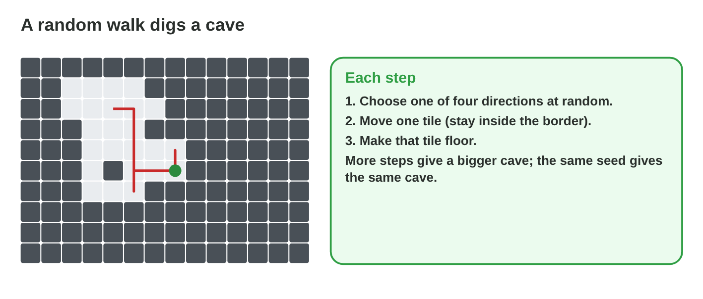
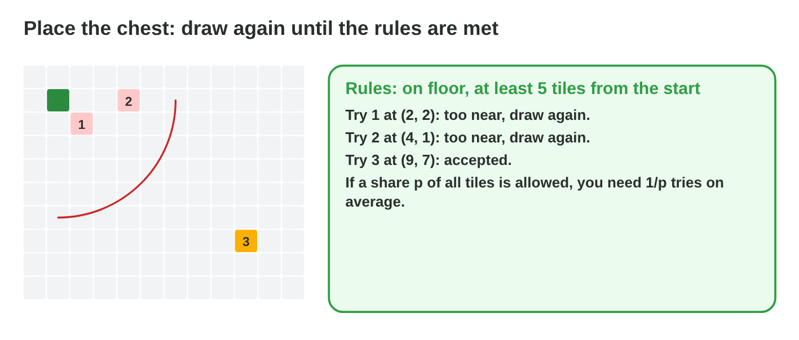
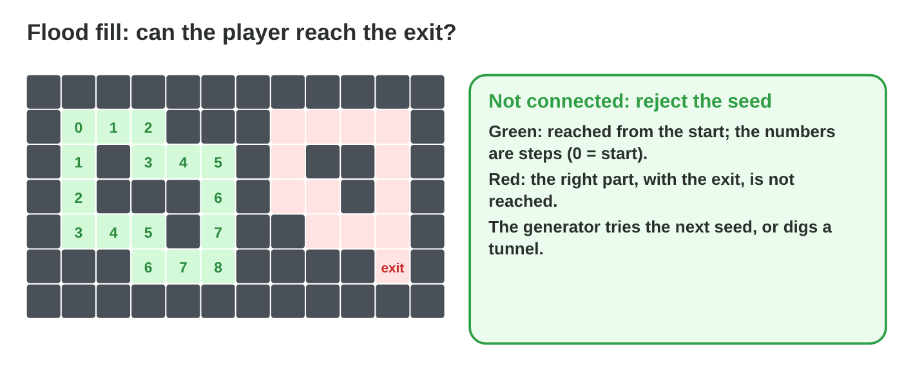
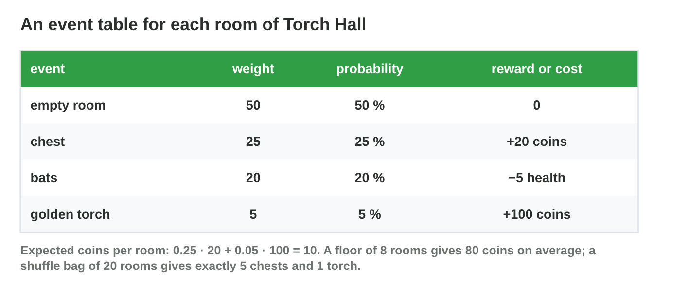
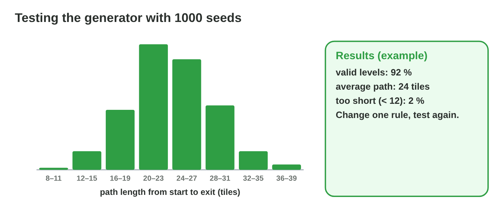

This page is the interactive version of the lesson notes (PDF). Each section
has a short summary, a picture, a **Do it** task and one set of questions.
The full explanations, examples and exercises are in the notes.

## Key terms



## 28.1 Seeds: the same seed, the same level

- Same **seed** + same code = **same level**.
- Save and show the seed; a shared seed for a daily challenge.
- A separate PRNG for the level.

{width=94%}

::: {.callout-warning title="Watch out!"}
Do not share the level's PRNG with things that change while playing.
:::

::: {.callout-note title="Do it · Same seed"}
In **Cave Generator**, go to seed 43 and back to 42. What stays the same?
:::

::: {.callout-tip title="Try it 1 · Seeds"}
Choose the right answer.

::: {.match extra="a faster CPU|a bigger grid"}
how a tester can repeat a floor
:   with the seed of the floor

the same floor for all players today
:   a shared daily seed

a new floor every time
:   a new seed, for example from the time

why the level has its own PRNG
:   so player actions do not change it
:::
:::

## 28.2 A random-walk cave

- Walls everywhere; a walker moves one random step at a time and digs.
- More steps, a bigger cave; always **connected**.

{width=94%}



::: {.callout-warning title="Watch out!"}
160 steps do not give 160 floor tiles: the walker repeats tiles.
:::

::: {.callout-note title="Do it · Walk on paper"}
A 7 × 7 grid, 12 die rolls (1–2 right, 3 left, 4 up, 5–6 down): colour the
cave.
:::

::: {.callout-tip title="Try it 2 · Random walks"}
Use Cave Generator. Choose the right answer.

::: {.match extra="0 %|100 % of the grid"}
the share of floor with 160 steps
:   about a quarter

why a walk cave is connected
:   the walker moves only to neighbours

where the exit goes
:   the farthest reachable tile

valid walk caves in 100 seeds
:   all of them
:::
:::

## 28.3 Placing items by rejection sampling

- Draw a candidate; break a rule → draw again.
- Expected draws: **1/p**. Always a **maximum**.

{width=94%}

::: {.callout-warning title="Watch out!"}
A loop without a maximum can freeze the game.
:::

::: {.callout-note title="Do it · Expected draws"}
Expected draws for p = 0.8, 0.25 and 0.05.
:::

::: {.callout-tip title="Try it 3 · Draws"}
Choose the expected number of draws.

::: {.match extra="0.4|80"}
p = 0.4
:   2.5

p = 0.25
:   4

p = 0.8
:   1.25

p = 0.05
:   20
:::
:::

## 28.4 Checking a level with flood fill

- **Flood fill** from the start: every reachable tile and its steps.
- Exit not reached → **reject the seed** (or dig a tunnel).
- Valid share q: expected seeds to try **1/q**.

{width=94%}

::: {.callout-warning title="Watch out!"}
Let the code check every seed, not your eyes.
:::

::: {.callout-note title="Do it · Find a broken seed"}
In **Cave Generator**, find a "random tiles" seed whose exit cannot be
reached; test 100 seeds with both methods.
:::

::: {.callout-tip title="Try it 4 · Checking"}
Choose the right answer.

::: {.match extra="the colour of the walls|the PRNG"}
what flood fill gives
:   every reachable tile and its steps

an exit that is not reached
:   reject the seed

valid share 0.6: expected seeds
:   about 1.7

valid share 0.8: expected seeds
:   1.25
:::
:::

## 28.5 Random events: tables and bags

- **Event table:** probability = weight ÷ sum of weights.
- Expected reward per room × rooms = per floor.
- A **shuffle bag** keeps the shares and spreads them evenly.

{width=94%}



::: {.callout-warning title="Watch out!"}
"Fair" means planned shares, not equal weights.
:::

::: {.callout-note title="Do it · A floor of events"}
In **Event Deck**, test 1000 floors with each method; compute the coins per
floor with a 30-coin chest.
:::

::: {.callout-tip title="Try it 5 · Events"}
Use Event Deck. Choose the right answer.

::: {.match extra="25|100"}
expected coins per room
:   10

expected coins per floor of 8 rooms
:   80

P(no chest in 8 rooms)
:   about 10 %

P(at least one torch in 8 rooms)
:   about 34 %
:::
:::

## 28.6 Testing the generator with many seeds

- Run **1000 seeds**; measure the valid share, the path length, chests,
  coins.
- Look at the average **and** the extremes; change one rule, test again.

{width=94%}

::: {.callout-warning title="Watch out!"}
A 1 % problem needs many seeds to show up.
:::

::: {.callout-note title="Do it · Test plan"}
Three numbers to measure, the number of seeds, one rule to change.
:::

::: {.callout-tip title="Try it 6 · Tests"}
Choose the right answer.

::: {.match extra="1|never"}
seeds for a good test
:   1000 or more

a 0.5 % problem in 1000 seeds
:   about 5 times

after a rule change
:   test again and compare

besides the average, look at
:   the extremes
:::
:::

## Game challenge: Generator Doctor {.challenge}

Work alone. Use every section of today.

Six reports: a bug that **cannot be repeated**, an **unreachable exit**,
**draws** for the chest, **coins** per room, floors **without a chest**,
and a change of the **walk steps**.



::: {.callout-tip title="Try it 7 · The reports"}
Choose the fix or the number.

::: {.match extra="remove the randomness|add more bats"}
a bug that cannot be repeated
:   save and show the seed

the exit cannot be reached
:   flood fill and reject the seed

floors without a chest
:   deal the rooms from a shuffle bag

the walk steps were changed
:   test 1000 seeds again
:::
:::

::: {.callout-tip title="Try it 8 · Compute (harder)"}
Choose the right answer.

::: {.match extra="0.3|24"}
empty 60, chest 30 (+10), torch 10 (+50): coins per room
:   8

the same table, 6 rooms
:   48

P(no chest in 6 rooms), p = 0.3
:   about 0.118

1 − 0.95⁸
:   about 0.34
:::
:::

## Summary {.summary}

- A seed repeats a level; give the level its own PRNG.
- A random walk digs a connected cave.
- Rejection sampling needs 1/p draws on average, and a maximum.
- Flood fill checks the level; reject broken seeds.
- Event tables and shuffle bags plan the rewards of a floor.
- Test the generator with many seeds.
