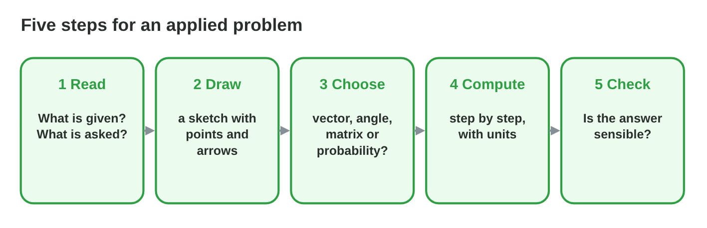
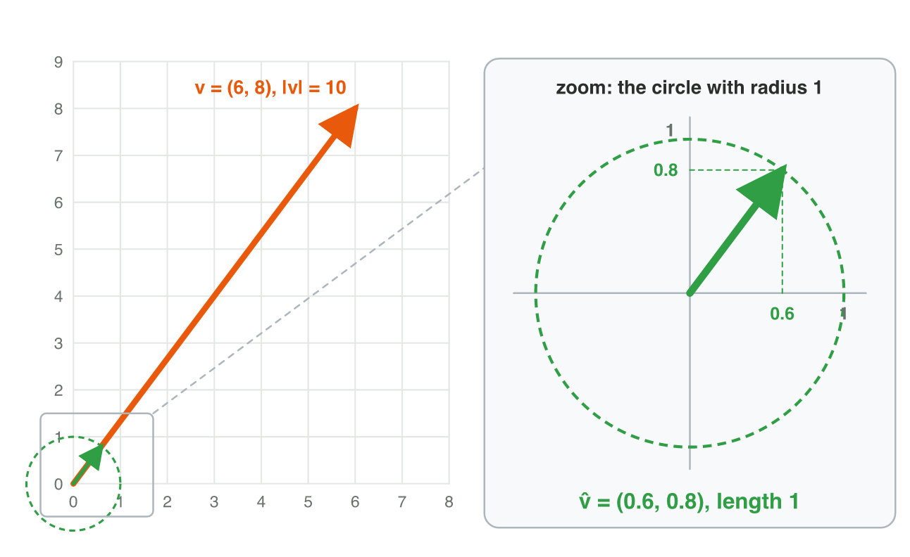
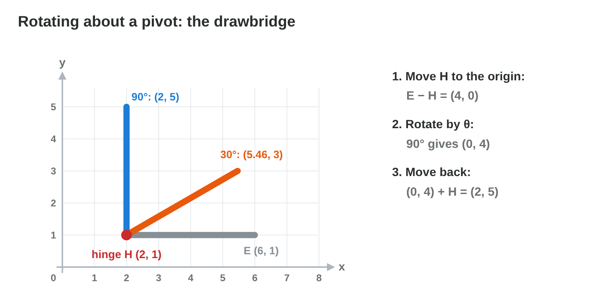
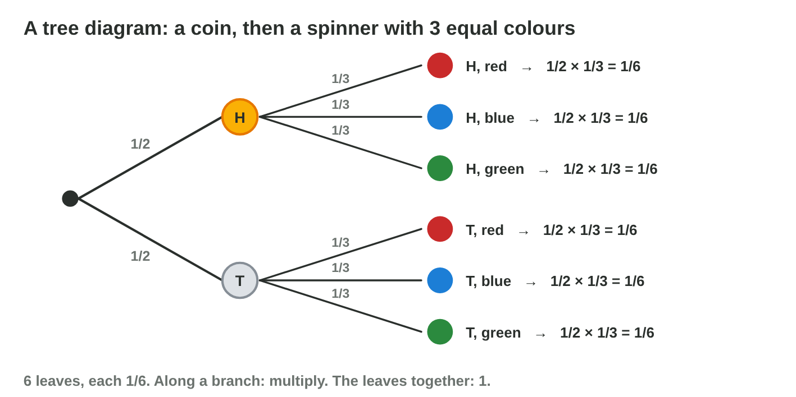

No new ideas today: three short problems, one with vectors, one with
transformations and one with probability. Do each one alone. Tap, sort or
type your answer at every step: the page checks it at once and tells you
why.

## Recall

{width=88%}

- **Five steps:** read (given, asked), draw, choose the tool, compute,
  check.
- **Vectors:** step B − A, length, unit direction; velocity = speed × unit
  direction; time = distance ÷ speed. In front if facing · (E − T) > 0.
- **About a pivot:** subtract the pivot, turn or scale, add the pivot.
  **Probability:** at least one in n tries = 1 − (1 − p)ⁿ; expected
  number = n × p.

::: {.callout-tip title="Try it 1 · Which tool?"}
Choose the tool for each question. You can use an answer more than once.

::: {.match extra="a truth table"}
How long does a pod need from A to B?
:   a vector and its length

    Why: Time = the length of B − A ÷ the speed.

Where is the arm's tip after a turn about its pivot?
:   a transformation about a pivot

    Why: Subtract the pivot, turn, add the pivot.

How often does at least one of 3 shots hit?
:   probability

    Why: It is 1 − P(no hit).
:::
:::

## Activity 1 · The rescue pod

A rescue pod at (−3, 2) flies to a ship at (9, 7) at 2.6 units per second.

{width=80%}

::: {.callout-note title="Activity 1 · Flight to the ship · 18 min"}
1. Draw the pod and the ship. Find the step and the distance.
2. Find the flight time.
3. Find the unit direction and the velocity.
4. Check: does the velocity × the flight time give the step?

*Your product:* a sketch and four results.

::: {.fill answer="13" hint="The step is (9, 7) − (−3, 2). Then √(x² + y²)."}
Step 1: what is the distance from the pod to the ship?

Why: The step is (12, 5), and √(144 + 25) = √169 = 13.
:::

::: {.fill answer="5" unit="s" hint="Distance ÷ speed."}
Step 2: what is the flight time at 2.6 units per second?

Why: 13 ÷ 2.6 = 5 seconds.
:::

::: {.choice}
Steps 3–4: what is the velocity of the pod?

- [x] (2.4, 1)

  Why: 2.6 × (12/13, 5/13) = (2.4, 1); check: 5 × (2.4, 1) = (12, 5), the step.

- [ ] (12, 5)

  Why: (12, 5) is the whole step; the velocity is the move in one second.

- [ ] (31.2, 13)

  Why: Multiply the unit direction by the speed, not the whole step.
:::
:::

::: {.callout-tip title="Try it 2 · Flights and seeing"}
Choose the right answer.

::: {.match extra="7|(6, 8)"}
A drone flies from (1, 1) to (7, 9). What is the distance?
:   10

    Why: (6, 8) has the length 10.

The same drone flies at 2 units per second. What is the flight time?
:   5 s

    Why: 10 ÷ 2 = 5.

A turret at (0, 0) faces (0, 1). Is a target at (0, −2) in front or behind?
:   behind

    Why: (0, 1) · (0, −2) = −2 < 0.
:::
:::

## Activity 2 · The crane arm

A crane arm has its pivot at P = (−1, 2) and its tip at A = (2, 6).

{width=80%}

::: {.callout-note title="Activity 2 · Turn, then shrink · 15 min"}
1. Rotate the tip 90° counterclockwise about the pivot.
2. Then scale the new tip by 0.5 about the pivot.
3. Check: how long is the arm before and after?

*Your product:* two points and one check.

::: {.order}
Step 1: put the steps of the turn about P = (−1, 2) in order.

1. Subtract the pivot: A − P = (3, 4).
2. Turn by 90°: (3, 4) → (−4, 3).
3. Add the pivot back: (−4, 3) + (−1, 2) = (−5, 5).

Why: Turn about a pivot: subtract it, rotate, then add it back.
:::

::: {.fill answer="(−3, 3.5)" hint="(−4, 3) × 0.5, then + P."}
Step 2: where is the tip after the scale by 0.5 about P? Type (x, y).

Why: (−4, 3) × 0.5 = (−2, 1.5); + (−1, 2) = (−3, 3.5).
:::

::: {.choice}
Step 3: how long is the arm before and after?

- [x] 5, then 2.5

  Why: |(3, 4)| = 5; the turn keeps it, and the scale by 0.5 halves it.

- [ ] 5, then 5

  Why: The turn keeps the length, but the scale by 0.5 halves it.

- [ ] 7, then 3.5

  Why: The length is √(3² + 4²) = 5, not 3 + 4.
:::
:::

::: {.callout-tip title="Try it 3 · About a pivot"}
Choose the right answer.

::: {.match extra="(−2, 5)|(5, 2)"}
Rotate (5, 2) by 90° about the pivot (3, 2). Where is it?
:   (3, 4)

    Why: (2, 0) → (0, 2) → + (3, 2) = (3, 4).

Scale (5, 2) by 2 about the pivot (3, 2). Where is it?
:   (7, 2)

    Why: (2, 0) × 2 = (4, 0) → + (3, 2) = (7, 2).

What happens if you rotate (5, 2) by 90° about the origin by mistake?
:   the arm leaves its pivot

    Why: (−y, x) = (−2, 5) is far from the pivot (3, 2).
:::
:::

## Activity 3 · Shots and crystals

A turret hits with p = 0.5 per shot and fires 3 shots. A mining drone
visits 40 asteroids; each holds a crystal with p = 0.2.

{width=80%}

::: {.callout-note title="Activity 3 · How often? · 15 min"}
1. What is P(no hit in 3 shots)? What is P(at least one hit)?
2. What is the expected number of hits in 3 shots?
3. What is the expected number of crystals in 40 asteroids?

*Your product:* four numbers with one line of working each.

::: {.choice}
Step 1: what are P(no hit in 3 shots) and P(at least one hit)?

- [x] 1/8 and 7/8

  Why: 0.5³ = 1/8, and the complement is 1 − 1/8 = 7/8.

- [ ] 1/8 and 3/8

  Why: "At least one" is the complement of "none": 1 − 1/8.

- [ ] 3/2 and 1/2

  Why: A probability is never more than 1.
:::

::: {.sort}
Steps 2–3: sort the numbers. Which are probabilities, and which are
expected counts?

A probability
:   1/8, no hit in 3 shots

    Why: Between 0 and 1: a chance.

:   7/8, at least one hit

    Why: Also a chance, the complement of 1/8.

An expected count
:   1.5 hits in 3 shots

    Why: 3 × 0.5 = 1.5: an average number of hits, not a chance.

:   8 crystals in 40 asteroids

    Why: 40 × 0.2 = 8 crystals on average.
:::
:::

::: {.callout-tip title="Try it 4 · Probability"}
Choose the right answer.

::: {.match extra="1.6|0.2"}
p = 0.8, 2 shots. What is P(at least one hit)?
:   0.96

    Why: 1 − 0.2 × 0.2 = 0.96.

p = 0.25, 20 asteroids. How many crystals are expected?
:   5

    Why: 20 × 0.25 = 5.

p = 0.5, 2 shots. What is P(two hits)?
:   1/4

    Why: 0.5 × 0.5 = 1/4.
:::
:::

## At home · Task with AI

::: {.callout-note .ai-task title="Task with AI · A picture of the mission"}
An extra for the curious: let an AI assistant draw it. Copy the prompt
into an AI assistant that the university allows (for example Microsoft
Copilot with your university account), and look at the picture.

::: {.prompt}
Draw a grid from −8 to 10 on both axes. Draw the points A = (−3, 2) and
B = (9, 7) and the arrow from A to B, and write its length next to it. Draw
the pivot P = (−1, 2), the tip Q = (2, 6) and the arm from P to Q. Then turn
the arm by 90° anticlockwise about P, and draw the turned arm and its new
tip in another colour.
:::

::: {.choice}
What should the picture show? The AI can be wrong: compare.

- [x] The arrow (12, 5) with the length 13, and the turned arm with its tip at (−5, 5).

  Why: Q − P = (3, 4); turned by 90° it is (−4, 3); + P = (−5, 5).

- [ ] The turned arm with its tip at (−6, 2).

  Why: (−6, 2) turns Q about the origin; the turn is about P.
:::

::: {.try-change}
**Change:** turn the arm by 180° instead of 90°, and ask again.

::: {.choice}
What changes?

- [x] The tip goes to (−4, −2), on the other side of P; the arm is still 5 long.

  Why: 180° turns (3, 4) into (−3, −4); + P = (−4, −2).

- [ ] The arm gets twice as long.

  Why: A turn keeps every length.
:::
:::

::: {.try-change}
**Change:** move B to (3, 10), and ask again.

::: {.choice}
What changes?

- [x] The arrow from A to B is (6, 8), with the length 10; the arm does not change.

  Why: (3, 10) − (−3, 2) = (6, 8), and √(36 + 64) = 10.

- [ ] The arm turns to a new place.

  Why: The arm uses P and Q only; moving B does not change it.
:::
:::

**Your own idea:** change one more number or word, and look again. The AI
can be wrong: compare its result with the answers.
:::

## Wrap-up {.summary}

- You can solve a game problem with the five steps.
- You can find a flight time and a velocity, and turn and scale about a
  pivot.
- You can compute the chances and the expected numbers of shots and drops.
