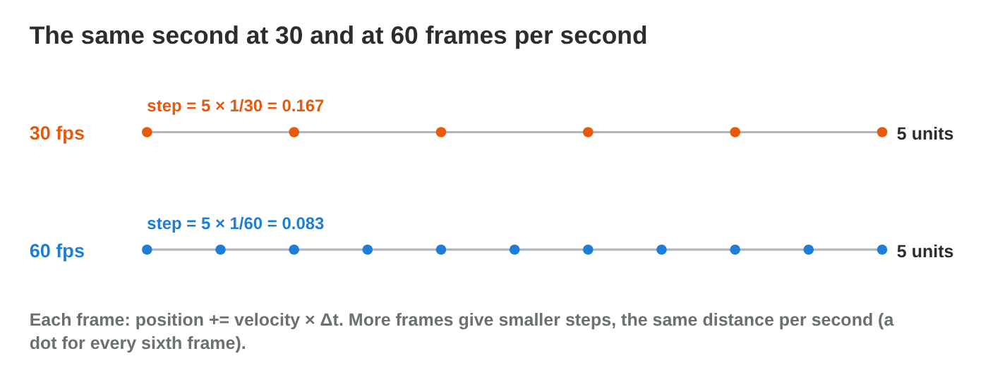
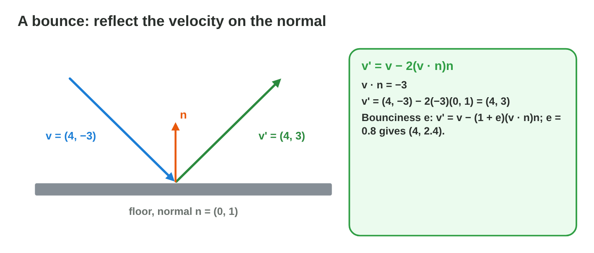
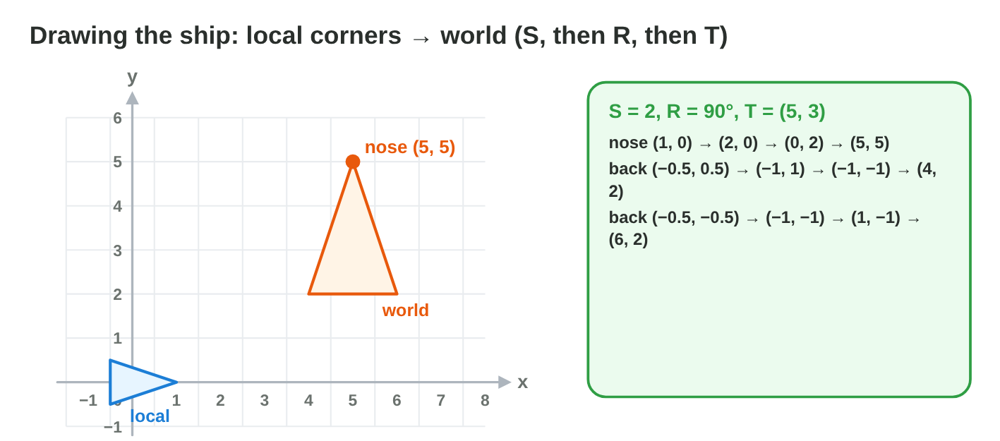

No new ideas today: three short problems that use Lectures 2, 3, 4 and 6 on
the shuttle of a game. Do each one alone. Tap, sort or type your answer at
every step: the page checks it at once and tells you why.

## Recall

- velocity = speed × unit direction; normalize the input first. Scaling a
  velocity by a time gives a distance (Lecture 2).
- atan2(y, x) gives the angle of a vector (Lecture 4). The part of v along a
  unit normal n̂ is (v · n̂) n̂ (Lecture 3).
- World point = T · R · S · local point: scale, then rotate, then move
  (Lecture 6).

::: {.callout-tip title="Try it 1 · Recall"}
Choose the right answer.

::: {.match extra="(1, 1)|90°"}
What is the unit vector of the input (0, 5)?
:   (0, 1)

    Why: (0, 5) ÷ 5.

Which angle does atan2 give for the vector (5, 5)?
:   45°

    Why: both parts are equal and positive: the diagonal of quadrant I.

What is (3, −4) · (0, 1)?
:   −4

    Why: 3 × 0 + (−4) × 1.
:::
:::

## Activity 1 · Fly the shuttle

The shuttle of *Star Dock* flies with the speed 6 units per second. The game
moves it by velocity × Δt in every frame: Δt = 1/30 s at 30 frames per
second (fps) and 1/60 s at 60 fps. The keys give the input: right (1, 0),
up (0, 1), right and up (1, 1); a stick can give (−3, 4).

{width=88%}



::: {.callout-note title="Activity 1 · Speed, steps and input · 18 min"}
1. The shuttle moves right. Find the step per frame at 30 fps and at
   60 fps. How far does it fly in one second at each frame rate?
2. The input is (1, 1) and the game does not normalize it. Is the shuttle
   too fast or too slow? Which velocity does it get with a normalized
   input?
3. The stick gives (−3, 4) and the speed is 10. Find the velocity.
4. In **Move Lab**, fly up and right with "normalize input" off, then on.

*Your product:* two steps, one velocity for (1, 1), one for (−3, 4), and one
sentence on what normalizing changes.

::: {.fill answer="0.2" hint="speed × Δt = 6 × 1/30."}
Step 1: what is the step per frame at 30 fps?

Why: 6 × 1/30 = 0.2; at 60 fps it is 6 × 1/60 = 0.1.
:::

::: {.choice}
Step 1: how far does the shuttle fly in one second?

- [x] 6 units at both frame rates

  Why: 30 × 0.2 = 6 and 60 × 0.1 = 6: Δt keeps the speed the same.

- [ ] 12 units at 60 fps

  Why: At 60 fps each step is half as long: 60 × 0.1 = 6.

- [ ] 3 units at 60 fps

  Why: Twice as many steps of half the size give the same 6 units.
:::

::: {.choice}
Step 2: the input (1, 1) is not normalized. What happens?

- [x] The shuttle is too fast; normalized it gets about (4.3, 4.3).

  Why: (6, 6) is about 8.5 long; (0.71, 0.71) × 6 ≈ (4.3, 4.3) has the speed 6.

- [ ] The shuttle is too slow.

  Why: (1, 1) is longer than 1, so the speed is bigger, not smaller.

- [ ] The speed is right.

  Why: Only a unit vector keeps the speed 6 in every direction.
:::

::: {.fill answer="(−6, 8)" hint="(−3, 4) has the length 5: normalize, then × 10."}
Step 3: the stick gives (−3, 4) and the speed is 10. What is the velocity?
Type (x, y).

Why: (−3, 4) ÷ 5 = (−0.6, 0.8); × 10 = (−6, 8).
:::
:::

::: {.callout-tip title="Try it 2 · Steps and input"}
Choose the right answer.

::: {.match extra="0.5|(0, −2)"}
The speed is 9 and the game runs at 30 fps. What is the step per frame?
:   0.3

    Why: 9 × 1/30 = 0.3.

What is the normalized stick input (0, −2)?
:   (0, −1)

    Why: (0, −2) ÷ 2.

The speed is 5 and the input (1, 1) is not normalized. Is the shuttle too fast or too slow?
:   too fast

    Why: (5, 5) is longer than 5: the long side of a triangle.
:::
:::

## Activity 2 · Face the velocity and bounce

The sprite of the shuttle is drawn facing +x, so the game turns it by the
angle atan2(v~y~, v~x~). When the shuttle hits a wall, the part along the
wall stays and the part into the wall turns around:
v' = v − 2 (v · n̂) n̂, with n̂ the unit normal of the wall. This is the
split of Lecture 3, with the part along the normal taken away twice.

{width=86%}



::: {.callout-note title="Activity 2 · Facing and bouncing · 18 min"}
1. Find the facing angle for the velocities (0, −2), (4, −4) and (−3, −3).
2. The shuttle hits the floor (n̂ = (0, 1)) with v = (4, −3). Find v · n̂
   and the velocity after the bounce. Does it now move up or down?
3. It hits the left wall (n̂ = (1, 0)) with v = (−5, 1). Find the velocity
   after the bounce.
4. Check the floor bounce in **Bounce Lab**.

*Your product:* three angles and two velocities after a bounce.

::: {.sort}
Step 1: which facing angle atan2(v~y~, v~x~) does each velocity get? Sort
them.

−90°
:   (0, −2)

    Why: Straight down.

:   (0, −5)

    Why: Also straight down: the length does not change the angle.

−45°
:   (4, −4)

    Why: Down-right, on the diagonal.

:   (1, −1)

    Why: The same direction as (4, −4).

−135°
:   (−3, −3)

    Why: Down-left: x and y are both minus.
:::

::: {.order}
Step 2: put the steps of the floor bounce in order.

1. v · n̂ = (4, −3) · (0, 1) = −3.
2. −2 (v · n̂) n̂ = −2 × (−3) × (0, 1) = (0, 6).
3. v' = (4, −3) + (0, 6) = (4, 3): it now moves up.

Why: v' = v − 2 (v · n̂) n̂: the part into the floor turns around. Bounce Lab shows (4, 3).
:::

::: {.fill answer="(5, 1)" hint="v · n̂ = −5; take away 2 × (−5) × (1, 0)."}
Step 3: what is the velocity after the left wall? Type (x, y).

Why: v · n̂ = −5; v' = (−5, 1) − 2 × (−5) × (1, 0) = (−5, 1) + (10, 0) = (5, 1).
:::
:::

::: {.callout-tip title="Try it 3 · Facing and bouncing"}
Choose the right answer.

::: {.match extra="(−3, −2)|135°"}
What is the velocity of (3, −2) after a bounce on the floor, n̂ = (0, 1)?
:   (3, 2)

    Why: v · n̂ = −2; (3, −2) + (0, 4).

What is the facing angle of the velocity (6, 6)?
:   45°

    Why: atan2(6, 6): the diagonal of quadrant I.

What is the velocity of (2, 6) after a bounce on the ceiling, n̂ = (0, −1)?
:   (2, −6)

    Why: v · n̂ = −6; (2, 6) − 2 × (−6) × (0, −1) = (2, 6) − (0, 12).
:::
:::

## Activity 3 · Draw the shuttle and check its code

The nose of the shuttle is at (1, 0) in its own (local) coordinates. The
game draws every corner with world point = T · R · S · local point: scale
first, then rotate, then move. Before the shuttle may fly, the test pilots
check six numbers of its movement code in *Pilot Check*.

{width=86%}



::: {.callout-note title="Activity 3 · Local to world · 18 min"}
1. Scale 2, angle 90°, position (5, 3): where is the nose in the world?
   Write the point after each step.
2. Scale 1, angle 180°, position (2, 4): where are the corners (1, 0) and
   (−0.5, 0.5)?
3. Play **Pilot Check** and answer its six questions.

*Your product:* three world points and your score in Pilot Check.

::: {.order}
Step 1: put the points of the nose in the order of the steps.

1. local: (1, 0)
2. after the scale by 2: (2, 0)
3. after the turn by 90°: (0, 2)
4. after the move by (5, 3): (5, 5)

Why: world point = T · R · S · local point: scale first, then rotate, then move.
:::

::: {.choice}
Step 2: scale 1, angle 180°, position (2, 4). Where is the corner
(−0.5, 0.5)?

- [x] (2.5, 3.5)

  Why: 180° gives (0.5, −0.5); + (2, 4) = (2.5, 3.5). The nose (1, 0) goes to (1, 4).

- [ ] (1.5, 4.5)

  Why: That only moves the corner: the turn of 180° is missing.

- [ ] (−2.5, −3.5)

  Why: The position (2, 4) is added after the turn, not turned with it.
:::
:::

::: {.callout-tip title="Try it 4 · Local to world"}
Choose the world point.

::: {.match extra="(4, 3)|(0, 0)"}
The nose (1, 0) with scale 1, angle 90° and position (3, 3).
:   (3, 4)

    Why: (1, 0) → (0, 1) → (0, 1) + (3, 3).

The nose (1, 0) with scale 2, angle 0° and position (1, 1).
:   (3, 1)

    Why: (2, 0) + (1, 1).

Which comes first: rotate or move?
:   rotate, then move

    Why: moving first would make the shuttle circle around the origin.
:::
:::

## Wrap-up {.summary}

- You can move a game object at the same speed on every computer and in
  every direction.
- You can turn a sprite to face its velocity and bounce it off a wall.
- You can draw a sprite in the world with scale, rotation and position.
