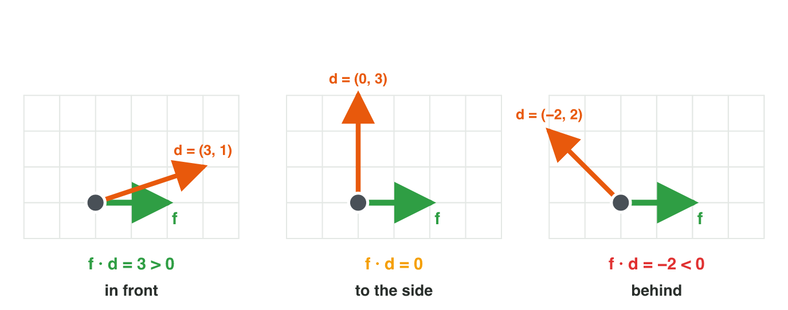
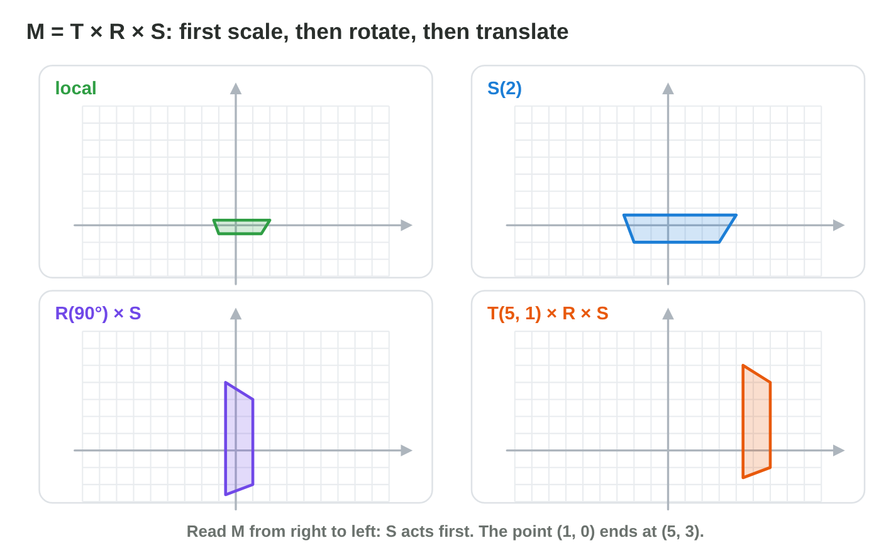
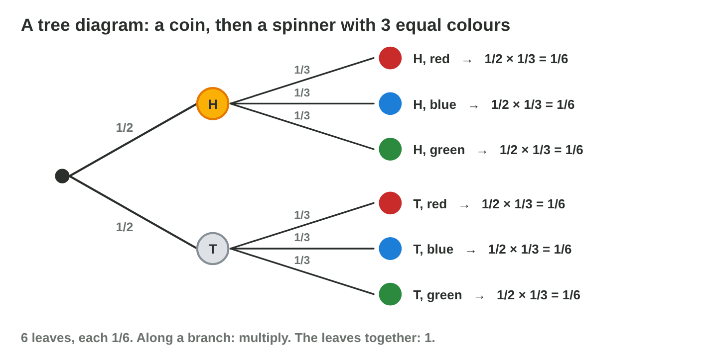
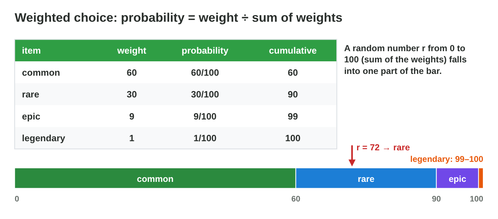
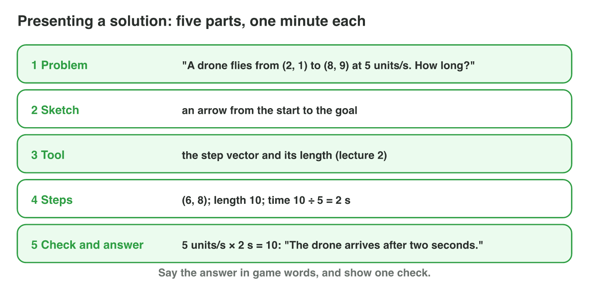

## Keywords



## 19.1 Vectors (lectures 1–5)

:::: {.columns}
::: {.column width="50%"}
- The step from A to B is B − A, and its length is √(x² + y²).
- The velocity is the speed times the unit direction.
- The sign of the dot product says in front or behind.
- **Do it:** A cart rolls from (2, −1) to (8, 7) at 5 units per second. How long does it take?
:::
::: {.column width="50%"}

:::
::::

## Example · A patrol drone

A drone flies from (1, 1) to a tower at (4, 5) at 2.5 units per second.
**How long does it fly, and where is the tower for a guard at (1, 1) who looks along (0, 1)?**

::: {.reveal}
1. The step is (3, 4), its length is 5, and the flight takes **2 s**.
2. The dot product (0, 1) · (3, 4) = 4 is positive, so the tower is **in front**.
3. The cross product 0 × 4 − 1 × 3 = −3 is negative, so it is to the **right**.
:::

## Try it 1 · Vectors

a) How long is the vector (6, 8)?
b) A guard looks along (1, 0), and d = (−2, 3). Is the player in front or behind?
c) What is the velocity for the speed 10 and the unit direction (0.6, 0.8)?

::: {.answer}
a) 10
b) behind
c) (6, 8)
:::

## 19.2 Angles and matrices (lectures 6–10)

:::: {.columns}
::: {.column width="50%"}
- The direction at θ is (cos θ, sin θ), and atan2(y, x) gives the angle.
- R(90°) turns (x, y) into (−y, x).
- One matrix M = T × R × S moves an object.
- **Do it:** Rotate (4, 2) by 90° about the pivot (2, 2). Where does it go?
:::
::: {.column width="50%"}

:::
::::

## Example · The cannon on the ship

A cannon sits at (2, 0) on a ship that is turned by 90° and stands at (5, 1).
**Where is the cannon, and which way does it fire?**

::: {.reveal}
1. R(90°) turns (2, 0) into (0, 2), and + (5, 1) gives **(5, 3)**.
2. The firing direction (1, 0) only turns, so it becomes **(0, 1)**.
3. The angle of (0, 1) is **90°**.
:::

## Try it 2 · Turning and moving

a) What is R(90°) × (0, 1)?
b) What is the angle of the vector (−3, 0)?
c) Where does M = T(4, 4) send the direction (0, 1, 0)?

::: {.answer}
a) (−1, 0)
b) 180°
c) (0, 1, 0)
:::

## 19.3 Logic (lectures 11–12)

:::: {.columns}
::: {.column width="50%"}
- A truth table with n variables has 2^n^ rows.
- De Morgan turns ¬(p ∧ q) into ¬p ∨ ¬q.
- In an else-if chain, the first true rule wins.
- **Do it:** Rewrite ¬(p ∧ ¬q) with De Morgan. What do you get?
:::
::: {.column width="50%"}

:::
::::

## Live demo · Truth Table Lab



## Try it 3 · Rules

a) In how many rows does the chest (k ∨ c) ∧ ¬t open?
b) The chain checks hp < 30 first, then hp < 10. Which rule never runs?
c) Which values test the edges of "energy ≥ 50"?

::: {.answer}
a) 3
b) the rule for hp < 10
c) 49, 50 and 51
:::

## 19.4 Probability (lectures 13–14)

:::: {.columns}
::: {.column width="50%"}
- P(A) is the number of outcomes in A divided by all outcomes.
- Without putting back, the second fraction changes.
- The expected value is the sum of value times probability.
- **Do it:** Find P(sum ≥ 10) for two dice. What is it?
:::
::: {.column width="50%"}

:::
::::

## Example · Tokens and a dice stand

A chest holds 2 gold and 3 wood tokens, and a dice stand costs 2 coins and pays 6 coins for a 6.
**What is P(both gold) in two draws, and is the stand fair?**

::: {.reveal}
1. Without putting back, P(both gold) = 2/5 × 1/4 = **1/10**.
2. E(win) = 6 × 1/6 = **1 coin**.
3. The expected gain is 1 − 2 = **−1 coin**, so the stand is not fair.
:::

## Try it 4 · Chance

a) What is P(sum = 4) with two dice?
b) What is E for a crate with 0 (0.5), 20 (0.4) and 100 (0.1) coins?
c) How many tries are needed on average with p = 0.25?

::: {.answer}
a) 1/12
b) 18
c) 4
:::

## 19.5 Randomness (lectures 15, 16, 18)

:::: {.columns}
::: {.column width="50%"}
- The same seed gives the same numbers and the same level.
- A weighted choice gives each item its weight divided by the sum.
- The chance of at least one drop is 1 − (1 − p)ⁿ.
- **Do it:** Which item does r = 81 give with the weights 50, 30, 15 and 5?
:::
::: {.column width="50%"}

:::
::::

## Live demo · Bag Lab



## Example · Loot and a pearl

The loot weights are 70, 25 and 5, and a pearl drops with p = 0.5.
**Which item does r = 93.4 give, and what is P(at least one pearl in 3 dives)?**

::: {.reveal}
1. The cumulative weights are 70, 95 and 100, so r = 93.4 gives **rare**.
2. P(no pearl in 3 dives) = (1/2)³ = **1/8**.
3. P(at least one pearl) = 1 − 1/8 = **7/8**, not 100 %.
:::

## Try it 5 · Randomness

a) Which values does Random.Range(0, 4) give?
b) What is P(at least one drop in two tries) with p = 0.2?
c) A 25 % crit missed five times. What is its chance on the next roll?

::: {.answer}
a) 0, 1, 2 and 3
b) 0.36
c) 25 %
:::

## 19.6 Solve and present (lectures 17–18)

:::: {.columns}
::: {.column width="50%"}
- We solve with five steps: read, draw, choose the tool, compute, check.
- We present in five parts, about one minute each.
- We say the answer in game words.
- **Do it:** Find E for a chest with the weights 6, 3 and 1, worth 10, 40 and 200 coins. Then present it.
:::
::: {.column width="50%"}

:::
::::

## Try it 6 · Presenting

a) What comes first in a presentation?
b) What comes after the sketch?
c) Which check catches a probability of 1.3?

::: {.answer}
a) the problem in one sentence
b) the tool and why
c) A probability must be between 0 and 1.
:::

## Game challenge · Lucky Raft Finals



## Try it · One more lap (harder)

The facts: the raft sails from (1, 2) to the island (7, 10). The flag is at (3, 1), and the mast is at (1, 1).

a) How long does the raft need at 2.5 units per second?
b) Where is the flag after a turn of 180° about the mast?
c) What is the longest wait for a bag of 1 pearl in 10 dives?

::: {.answer}
a) 4 s
b) (−1, 1)
c) 18 dives
:::

## Summary

- Vectors give steps, lengths and directions, and the two products give front, back, left and right.
- Angles and matrices turn, scale and move objects with M = T × R × S.
- Logic writes the rules with truth tables, De Morgan and edge cases.
- Probability gives chances and expected values.
- Random numbers, weights and bags shape the luck that players feel.
- We solve with five steps and present the solution in five parts.
