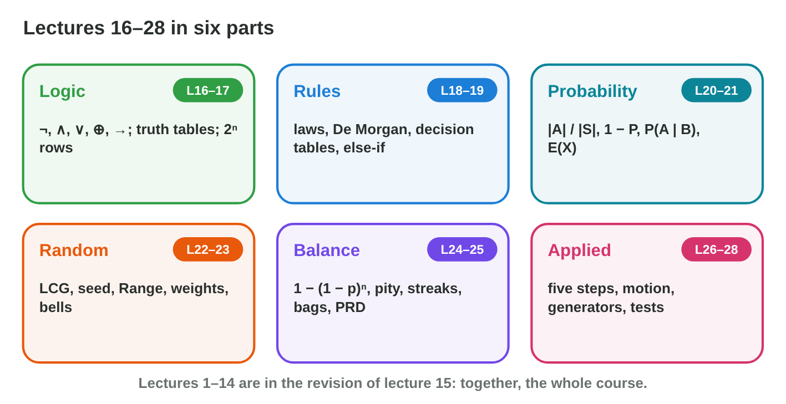
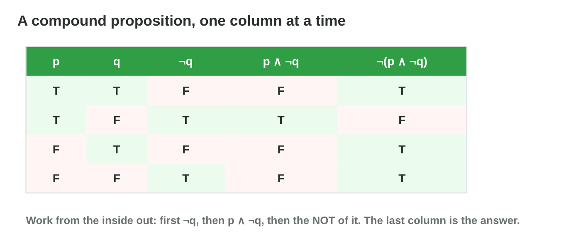
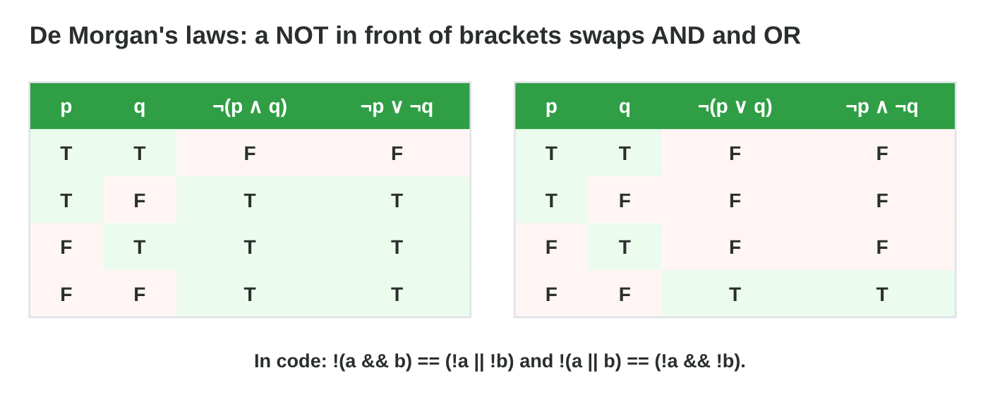

This page is the interactive version of the revision notes (PDF). Each
section repeats the key facts of one part of the course. It ends with a
**Do it** task and one set of questions. The full examples and the
exercises are in the notes.

## Key terms



{width=92%}

## 29.1 Logic and truth tables (lectures 16–17)

- ¬ NOT, ∧ AND (both), ∨ OR (at least one), ⊕ XOR (exactly one), → IF–THEN
  (false only for T → F).
- Precedence: NOT, AND, OR, then IF–THEN. n variables: 2^n^ rows.
- Chest: (k ∨ c) ∧ ¬t. With k = F, c = T, t = F the chest opens; 3 of 8
  rows are true.

{width=86%}



::: {.callout-warning title="Watch out!"}
p ∧ q ∨ r means (p ∧ q) ∨ r: AND comes before OR.
:::

::: {.callout-note title="Do it · Two tables"}
Build the tables of p → q and ¬p ∨ q. Are they equivalent?
:::

::: {.callout-tip title="Try it 1 · Logic"}
Use Truth Table Lab. Choose the right answer.

::: {.match extra="6|both T"}
How many rows has a table with 3 variables?
:   8

When is p → q false?
:   p is T and q is F

Which proposition is the same as p → q?
:   ¬p ∨ q

What is true in every row?
:   a tautology

How does p ∧ q ∨ r group?
:   (p ∧ q) ∨ r
:::
:::

## 29.2 Boolean algebra and game rules (lectures 18–19)

- **De Morgan:** ¬(p ∧ q) ≡ ¬p ∨ ¬q; ¬(p ∨ q) ≡ ¬p ∧ ¬q.
- Absorption: p ∨ (p ∧ q) ≡ p. Complement: p ∧ ¬p ≡ F.
- Else-if: the first true rule wins; put the specific rule first.
- Edge cases of "health < 30": 29, 30, 31.

{width=86%}

::: {.callout-warning title="Watch out!"}
¬(p ∨ q) is not ¬p ∨ ¬q: the OR becomes AND.
:::

::: {.callout-note title="Do it · Simplify and order"}
Simplify ¬(p ∧ ¬q) with De Morgan. Write the edge cases of "shield on when
energy ≥ 50".
:::

::: {.callout-tip title="Try it 2 · Rules"}
Choose the right answer.

::: {.match extra="¬a ∨ ¬b ∧ c|10, 20, 30"}
Use De Morgan on ¬(a ∧ b).
:   ¬a ∨ ¬b

Simplify p ∨ (p ∧ q).
:   p

Simplify ¬(¬a ∨ b) ∨ (a ∧ b).
:   a

Which rule is unreachable: if hp < 30, else if hp < 10?
:   the rule hp < 10

What are the edge cases of "energy ≥ 50"?
:   49, 50, 51
:::
:::

## 29.3 Probability and expected value (lectures 20–21)

- P(A) = |A| / |S|; P(not A) = 1 − P(A); two dice: 36 pairs.
- P(A | B) = P(A and B) / P(B); P(A and B) = P(A) × P(B | A).
- E(X) = x~1~p~1~ + x~2~p~2~ + …; fair: E(win) − price = 0; tries until a
  success: 1/p.

{width=86%}

::: {.callout-warning title="Watch out!"}
Without putting back, the second chance changes: 2/5 × 1/4, not 2/5 × 2/5.
:::

::: {.callout-note title="Do it · Two dice"}
Find P(sum ≥ 10) and P(double | sum ≥ 10) with a grid.
:::

::: {.callout-tip title="Try it 3 · Chance"}
Choose the right answer.

::: {.match extra="4/25|2"}
Two of 2 gold and 3 wood tokens without putting back: P(both gold)?
:   1/10

P(sum ≥ 10) with two dice?
:   1/6

P(double | sum ≥ 10)?
:   1/3

A stand costs 2 coins; a 6 wins 6 coins. Expected gain?
:   −1 coin

p = 0.25 per try. Average tries until a success?
:   4
:::
:::

## 29.4 Random numbers and distributions (lectures 22–23)

- LCG: x~n+1~ = (a · x~n~ + c) mod m; the seed is x~0~; same seed, same
  numbers.
- Random.Range(1, 7) gives 1 … 6 (integers: max excluded). Seed once.
- Weighted: P(i) = w~i~ / sum of weights; pick with cumulative weights.

{width=86%}

::: {.callout-warning title="Watch out!"}
Random.Range(1, 6) gives only 1 … 5.
:::

::: {.callout-note title="Do it · A loot table"}
Weights 50, 30, 15, 5: find the probabilities and the cumulative weights.
Which item does r = 81 give?
:::

::: {.callout-tip title="Try it 4 · Generators and weights"}
Choose the right answer.

::: {.match extra="38|0.25"}
(5 · 7 + 3) mod 16 = ?
:   6

Weights 70, 25, 5: P(epic)?
:   0.05

Weights 50, 30, 15, 5: which item does r = 81 give?
:   the third

Which values does Random.Range(0, 4) give?
:   0, 1, 2, 3

Same seed, same code: what happens?
:   the same level again
:::
:::

## 29.5 Balance, fairness and generation (lectures 24, 25, 28)

- At least one in n tries: 1 − (1 − p)^n^. Tries for 90 %:
  n ≥ ln 0.1 / ln(1 − p).
- Pity timer: a limit. Shuffle bag: exact shares. PRD: chance grows with
  misses.
- Independent tries have no memory. Rejection sampling: 1/p draws on
  average.

{width=86%}



::: {.callout-warning title="Watch out!"}
20 tries at 5 % do not make 100 %: 1 − 0.95^20^ ≈ 0.64.
:::

::: {.callout-note title="Do it · Drops and bags"}
p = 0.2: find P(at least one in 5 tries) and the tries for 90 %. Compare
the droughts in **Bag Lab**.
:::

::: {.callout-tip title="Try it 5 · Balance"}
Use Bag Lab. Choose the right answer.

::: {.match extra="1|0.2"}
p = 0.2, 5 tries: P(at least one)?
:   about 0.67

p = 0.2: tries for 90 % of the players?
:   11

A 25 % crit missed 5 times (independent). Next chance?
:   25 %

Shuffle bag, 1 crit in 4: the longest drought?
:   6 attacks

A quarter of the tiles are free. Expected draws?
:   4
:::
:::

## 29.6 Solving and presenting a mixed problem (lectures 26–27)

- Solve in five steps: read, draw, choose the tool, compute, check.
- Present in five parts: problem, sketch, tool, steps, check and answer.
- Say the answer in game words; one minute per part.

{width=92%}

::: {.callout-warning title="Watch out!"}
A number alone is not a solution: name the tool and show the check.
:::

::: {.callout-note title="Do it · Present one problem"}
Weights 6, 3, 1 with values 10, 40, 200 coins: find the expected coins and
present your solution in five parts.
:::

::: {.callout-tip title="Try it 6 · Presenting"}
Choose the right answer.

::: {.match extra="the final number only|the formula only"}
What comes first in a presentation?
:   the problem in one sentence

How do you say the answer?
:   as a sentence about the game

Which check fits a probability?
:   it is between 0 and 1

Weights 6, 3, 1 and values 10, 40, 200: expected coins?
:   38
:::
:::

## Game challenge: Lucky Raft Finals {.challenge}

Work alone. Use every section of today.

**Lucky Raft Finals** takes the raft past eight islands, one for each idea
of lectures 16–28. On each island, one problem from a game.



::: {.callout-tip title="Try it 7 · The islands"}
Choose the right answer.

::: {.match extra="yes|30"}
key ∧ ¬alarm with the key and the alarm on: does the gate open?
:   no

¬(storm ∨ night) is the same as?
:   ¬storm ∧ ¬night

A crate: 10 coins (0.7) or 50 coins (0.3). Expected coins?
:   22

x~1~ = (5 · 3 + 1) mod 8?
:   0

p = 0.1, two dives: P(at least one pearl)?
:   0.19
:::
:::

::: {.callout-tip title="Try it 8 · Mixed (harder)"}
Choose the right answer.

::: {.match extra="1/2|0.95"}
First die 6: P(sum ≥ 10)?
:   the second die 4, 5 or 6

p = 0.05, 20 tries: P(at least one)?
:   about 0.64

p = 0.1: dives for 90 % of the players?
:   22
:::
:::

## Summary {.summary}

- Logic: operators, precedence, truth tables and De Morgan.
- Rules: decision tables, else-if order and edge cases.
- Probability: counting, complement, conditions and expected value.
- Random numbers: seeds, ranges and weights.
- Balance and fairness: at least once, pity, bags, PRD and generator tests.
- Present a solution in five parts, with the answer in game words.
