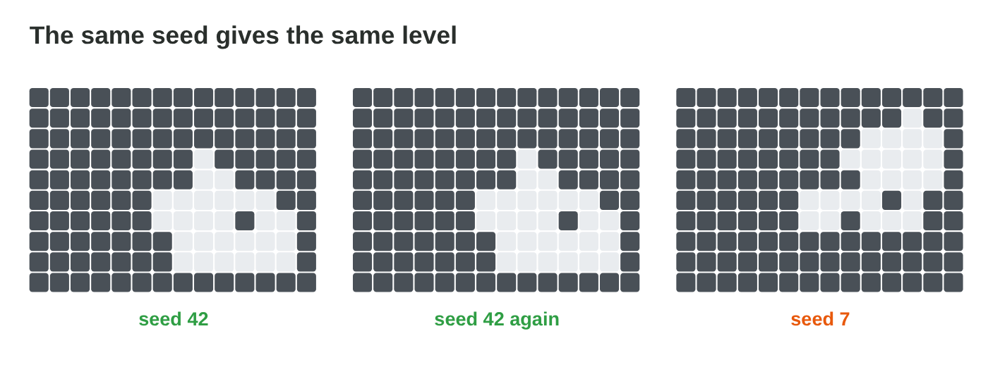

This page is the interactive version of the lesson notes (PDF). Each section
starts with a problem in a game. Then it explains the idea behind it. It ends
with a **Do it** task and one set of questions. Every question on this page
has its answer: try first, then check.

## Key terms



## 18.1 Seeds: the same seed, the same level

- Same **seed** + same code = **same level**.
- Save and show the seed; a shared seed for a daily challenge.
- A separate PRNG for the level.

{width=94%}

::: {.callout-warning title="Watch out!"}
Do not share the level's PRNG with things that change while playing.
:::

::: {.callout-note title="Do it · Same seed"}
In **Cave Generator**, go to seed 43 and back to 42. What stays the same?

::: {.check}
Everything: the walls, the start, the exit and the chest. A daily challenge
gives all players one seed, so they all play the same floor.
:::
:::

::: {.callout-tip title="Try it 1 · Seeds"}
Choose the right answer.

::: {.match extra="a faster CPU|a bigger grid"}
How can a tester repeat a floor with a bug?
:   with the seed of the floor

    Why: the same seed and code build the same floor.

How do all players get the same floor today?
:   a shared daily seed

    Why: everyone builds the floor from the same seed.

How does the game make a new floor every time?
:   a new seed, for example from the time

    Why: a different seed gives different numbers.

Why does the level have its own PRNG?
:   so player actions do not change it

    Why: other random events would use up numbers of the level.
:::
:::

## 18.2 A random-walk cave

- Walls everywhere; a walker moves one random step at a time and digs.
- More steps, a bigger cave; always **connected**.
- The exit goes on the floor tile farthest from the start.

{width=94%}



::: {.callout-warning title="Watch out!"}
160 steps do not give 160 floor tiles: the walker repeats tiles.
:::

::: {.callout-note title="Do it · Walk on paper"}
A 7 × 7 grid, 12 die rolls (1–2 right, 3 left, 4 up, 5–6 down): colour the
cave.

::: {.check}
A good cave is one connected piece around the middle, with fewer than 13
tiles, because the walker steps on some tiles again.
:::
:::

::: {.callout-tip title="Try it 2 · Random walks"}
Use Cave Generator. Choose the right answer.

::: {.match extra="0 %|100 % of the grid"}
About what share of the grid is floor with 160 steps?
:   about a quarter

    Why: the walker visits many tiles more than once.

Why is a walk cave always connected?
:   the walker moves only to neighbours

    Why: each new tile touches the tile before.

Where does the exit go?
:   the farthest floor tile

    Why: the player then crosses the whole cave.

The walker makes 20 steps. At most how many new floor tiles?
:   20

    Why: each step digs at most one new tile.
:::
:::

## 18.3 Placing items by rejection sampling

- Draw a candidate; break a rule → draw again.
- Expected draws: **1/p**. Always a **maximum**.
- The chest at least 6 steps away, 40 % allowed: 1/0.4 = 2.5 draws.

{width=94%}

::: {.callout-warning title="Watch out!"}
A loop without a maximum can freeze the game.
:::

::: {.callout-note title="Do it · Expected draws"}
Expected draws for p = 0.8, 0.25 and 0.05.

::: {.check}
1.25; 4; 20. With 0.05 the rule is very strict: allow more tiles, and keep
a maximum.
:::
:::

::: {.callout-tip title="Try it 3 · Draws"}
Choose the expected number of draws.

::: {.match extra="0.5|50"}
p = 0.5
:   2

    Why: 1 ÷ 0.5.

p = 0.1
:   10

    Why: 1 ÷ 0.1.

p = 0.2
:   5

    Why: 1 ÷ 0.2.

p = 1 (every tile is allowed)
:   1

    Why: the first draw always works.

p = 0.04. Expected draws?
:   25

    Why: 1 ÷ 0.04: a strict rule needs many draws.
:::
:::

## 18.4 Random events: tables and bags

- **Event table:** probability = weight ÷ sum of weights.
- Expected reward per room × rooms = per floor.
- Chest 25 % (+20), torch 5 % (+100): 10 coins per room, 80 per floor of 8.
- A **shuffle bag** keeps the shares and spreads them evenly.

{width=94%}



::: {.callout-warning title="Watch out!"}
"Fair" means planned shares, not equal weights.
:::

::: {.callout-note title="Do it · A floor of events"}
In **Event Deck**, test 1000 floors with each method; compute the coins per
floor with a 30-coin chest.

::: {.check}
Both methods give about 80 coins; the bag has far fewer floors without a
chest. With 30 coins: 7.5 + 5 = 12.5 per room, 100 per floor.
:::
:::

::: {.callout-tip title="Try it 4 · Events"}
Use Event Deck. Choose the right answer.

::: {.match extra="25|100"}
Empty 60, chest 30 (+10), torch 10 (+50). Expected coins per room?
:   8

    Why: 3 + 5.

The same table. Expected coins for 6 rooms?
:   48

    Why: 6 × 8.

A chest with p = 0.3 per room. P(no chest in 2 rooms)?
:   0.49

    Why: 0.7 × 0.7.

What does a shuffle bag change?
:   fewer unlucky floors, the same shares

    Why: each bag holds a fixed number of chests.
:::
:::

## 18.5 Testing the generator with many seeds

- Run **1000 seeds**; measure the path length, the chests, the coins.
- Look at the average **and** the extremes; change one rule, test again.

{width=94%}

::: {.callout-warning title="Watch out!"}
A 1 % problem needs many seeds to show up.
:::

::: {.callout-note title="Do it · Test plan"}
Three numbers to measure, the number of seeds, one rule to change.

::: {.check}
A good plan: three numbers (path length, chests, coins), 1000 or more
seeds, and one rule with a reason ("exit at least 15 steps away if many
paths are too short").
:::
:::

::: {.callout-tip title="Try it 5 · Tests"}
Choose the right answer.

::: {.match extra="1|never"}
How many seeds for a good test?
:   1000 or more

    Why: rare problems need many seeds to show up.

A problem on 0.5 % of the seeds. How often in 1000 seeds?
:   about 5 times

    Why: 1000 × 0.005.

What do you do after a rule change?
:   test again and compare

    Why: only then you know what the change did.

Besides the average, what do you look at?
:   the extremes

    Why: the most unlucky floors make players quit.
:::
:::

## Game challenge: Generator Doctor {.challenge}

Work alone. Use every section of today.

The testers of *Torch Hall* send six reports. A player wants a friend to play
**the same floor**. The walker of the cave makes **100 steps**: is every
tile connected? A monster must not stand within 3 steps of the start, and
**80 %** of the tiles are allowed. A room holds a chest with **20 % (+30
coins)** or a gem with **10 % (+50 coins)**. Some floors have **no gem**. A
new rule puts the exit **at least 20 steps** from the start.



::: {.callout-tip title="Try it 6 · The reports"}
Monster rule 80 % allowed; chest 20 % (+30), gem 10 % (+50) per room.
Choose the right answer.

::: {.match extra="0.8|40"}
What does the player share with the friend?
:   the seed of the floor

    Why: the same seed builds the same floor.

Expected tries to place the monster?
:   1.25

    Why: 1 ÷ 0.8.

Expected coins per room?
:   11

    Why: 6 + 5.

Which change spreads the gems but keeps the rate?
:   a shuffle bag

    Why: each bag holds a fixed number of gems.
:::
:::

::: {.callout-tip title="Try it 7 · A floor of 10 rooms (harder)"}
The same table: chest 20 % (+30), gem 10 % (+50). A floor has 10 rooms.
Choose the right answer.

::: {.match extra="11|20 %"}
Expected coins per floor?
:   110

    Why: 10 × 11.

Expected chests per floor?
:   2

    Why: 10 × 0.2.

A bag of 10 cards with the same shares. How many gem cards?
:   1

    Why: 10 % of 10.

The exit rule holds on 950 of 1000 seeds. What share fails?
:   5 %

    Why: 50 of 1000.

The floor uses rooms rolled one by one. P(no chest in 2 rooms)?
:   0.64

    Why: 0.8 × 0.8.
:::
:::

## Summary {.summary}

- The same seed and code build the same level: save and share the seed.
- A random walk digs a connected cave.
- Rejection sampling needs 1/p draws on average, and a maximum.
- An event table gives the expected reward; a shuffle bag spreads it evenly.
- Test a generator with many seeds; look at the average and the extremes.
