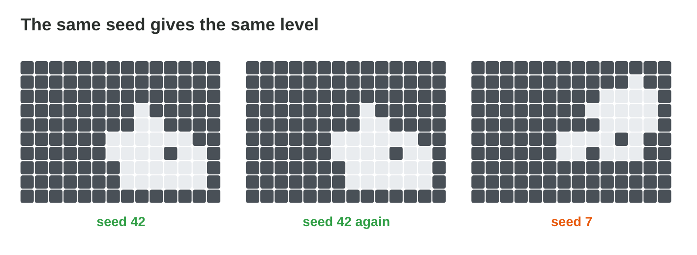
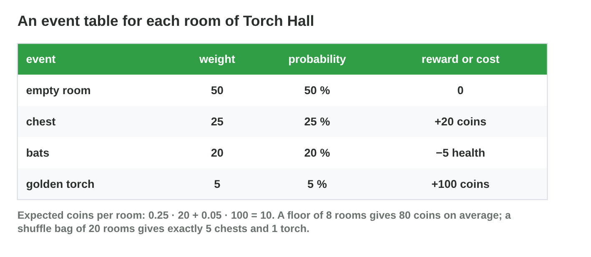
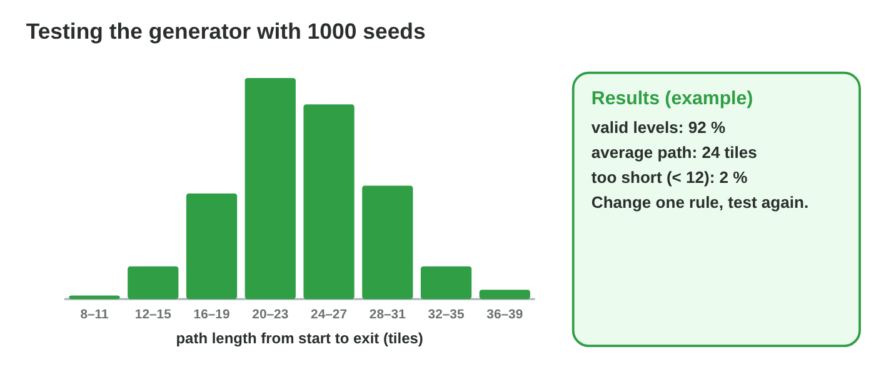

No new ideas today: three short problems that use Lectures 10, 11 and 12 on
the level generator of a game. Do each one alone. Tap, sort or type your
answer at every step: the page checks it at once and tells you why.

## Recall

- The same seed gives the same random numbers (Lecture 11). A success with
  probability p takes 1/p tries on average (Lecture 10).
- E = x₁p₁ + x₂p₂ + …: the long-run average per try (Lecture 10).
- A shuffle bag keeps the shares and spreads the results evenly
  (Lecture 12).

::: {.callout-tip title="Try it 1 · Recall"}
Choose the right answer.

::: {.match extra="a new seed|20"}
A tester wants to see the same random numbers again. What does the tester need?
:   the same seed

    Why: the same seed and the same code give the same numbers.

A rule allows 50 % of the tiles. How many draws are needed on average?
:   2

    Why: 1/p = 1/0.5.

A room gives 10 coins with p = 0.3, else nothing. What is E per room?
:   3

    Why: 10 × 0.3.
:::
:::

## Activity 1 · The same seed, the same cave

*Torch Hall* makes a new cave for every floor. It starts with walls
everywhere. A walker starts in the middle and moves one random step at a
time; every tile it steps on becomes floor. The exit goes on the floor tile
farthest from the start. All its random numbers come from one seed.

{width=86%}



::: {.callout-note title="Activity 1 · Seeds and steps · 15 min"}
1. In **Cave Generator**, write where the chest is with seed 42. Go to seed
   43, then back to 42. What stays the same?
2. A tester finds a bug on one floor. What must the tester write in the
   report? How can all players get the same floor today?
3. The walker makes 20 steps. At most how many new floor tiles can it make?
   Why are there often fewer?

*Your product:* three short answers, each with a reason.

::: {.choice}
Step 1: seed 42, then 43, then 42 again. What stays the same?

- [x] With seed 42, everything: the walls, the start, the exit and the chest.

  Why: The same seed gives the same random numbers, so the same cave.

- [ ] Only the start in the middle.

  Why: Every part of the cave comes from the seed, not only the start.

- [ ] Nothing: a random cave is always new.

  Why: Pseudo-random numbers repeat with the same seed.
:::

::: {.choice}
Step 2: what must the tester write in the bug report?

- [x] the seed of the floor

  Why: With the seed the team makes the same floor again; a shared daily seed gives everyone the same floor.

- [ ] the time of the game

  Why: The time does not make the floor again; the seed does.

- [ ] only a screenshot

  Why: A picture shows the bug, but it cannot rebuild the floor.
:::

::: {.choice}
Step 3: the walker makes 20 steps. At most how many new floor tiles?

- [x] 20, and often fewer

  Why: One new tile per step at most; the walker often steps on a tile again.

- [ ] 400

  Why: 20 steps can change at most 20 tiles.

- [ ] always exactly 20

  Why: A random walk often goes back to tiles that are already floor.
:::
:::

::: {.callout-tip title="Try it 2 · Seeds and steps"}
Choose the right answer.

::: {.match extra="a faster CPU|0"}
How does the game make a new floor every time?
:   a new seed, for example from the time

    Why: a new seed gives new random numbers.

Why is a walker cave always one connected piece?
:   the walker moves only to a neighbour tile

    Why: every new tile touches the tile before it.

The walker makes 30 steps. At most how many new floor tiles does it make?
:   30

    Why: one tile per step at most; repeated tiles add nothing.
:::
:::

## Activity 2 · A monster and the rooms

A monster must not stand within 3 steps of the start, so the game draws a
random floor tile and draws again when the rule fails; 80 % of the tiles
are allowed. Each room gets an event from a table: a chest with 25 %
(+20 coins), a torch with 5 % (+100 coins), and nothing with 70 %. A floor
has 8 rooms. The team compares the table with a shuffle bag of the same
shares.

{width=86%}



::: {.callout-note title="Activity 2 · Draws, coins and a bag · 20 min"}
1. How many draws does the monster need on average?
2. Find the expected coins per room and per floor of 8 rooms.
3. Find P(no chest in 2 rooms), with the table.
4. In **Event Deck**, test 1000 floors with the table, then with the bag.
   Compare the coins per floor and the floors without a chest.

*Your product:* one number of draws, two expected values, one probability
and one sentence on the bag.

::: {.fill answer="1.25" hint="On average 1/p draws, with p = 0.8."}
Step 1: how many draws does the monster need on average?

Why: 1 ÷ 0.8 = 1.25 draws.
:::

::: {.fill answer="10" unit="coins" hint="20 × 0.25 + 100 × 0.05 + 0 × 0.7."}
Step 2: what are the expected coins per room?

Why: 5 + 5 + 0 = 10 coins per room, so 8 × 10 = 80 coins per floor.
:::

::: {.fill answer="0.5625|56.25%|56%" tol="0.01" hint="No chest has 75 % in each room; two rooms: multiply."}
Step 3: what is P(no chest in 2 rooms)?

Why: 0.75 × 0.75 = 0.5625, about 56 %.
:::

::: {.choice}
Step 4: what does Event Deck show for the table and for the bag?

- [x] Both give about 80 coins; the bag has far fewer floors without a chest.

  Why: The bag spreads the chests but keeps their share.

- [ ] The bag gives more coins per floor.

  Why: The shares are the same, so the coins are the same on average.

- [ ] The table has fewer floors without a chest.

  Why: Pure random can miss the chest many times; the bag cannot.
:::
:::

::: {.callout-tip title="Try it 3 · Rooms"}
Empty 60 %, chest 30 % (+10 coins), torch 10 % (+50 coins). Choose the
right answer.

::: {.match extra="25|100"}
What is the expected number of coins per room?
:   8

    Why: 10 × 0.3 + 50 × 0.1 = 3 + 5.

What is the expected number of coins for 6 rooms?
:   48

    Why: 6 × 8.

What does a shuffle bag change?
:   fewer unlucky floors, the same shares

    Why: the bag keeps the shares and spreads the results.
:::
:::

## Activity 3 · The reports of the testers

The testers of *Torch Hall* send six reports. A player wants a friend to play
the same floor. A new monster rule allows 80 % of the tiles. A room holds a
chest with 20 % (+30 coins) or a gem with 10 % (+50 coins); a floor has 10
rooms, and some floors have no gem at all. A new rule puts the exit at least
20 steps from the start.

{width=86%}



::: {.callout-note title="Activity 3 · Answer the reports · 20 min"}
1. What does the player share with the friend?
2. Find the expected draws for the monster, and the expected coins per room
   and per floor.
3. P(no gem in a room) = 0.9; for 10 rooms it is 0.9¹⁰ ≈ 0.35. Which change
   gives every floor gems at the same rate?
4. After the exit rule changes, what does the team do? Then play
   **Generator Doctor** and answer the six reports.

*Your product:* four short answers and your score in Generator Doctor.

::: {.choice}
Step 1: what does the player share with the friend?

- [x] the seed of the floor

  Why: The same seed gives the friend exactly the same floor.

- [ ] a screenshot of the floor

  Why: A picture cannot rebuild the floor.

- [ ] the score

  Why: The score says nothing about the floor.
:::

::: {.fill answer="110" unit="coins" hint="Per room: 30 × 0.2 + 50 × 0.1. A floor has 10 rooms."}
Step 2: what are the expected coins per floor of 10 rooms?

Why: 6 + 5 = 11 coins per room, so 110 per floor. The monster needs 1 ÷ 0.8 = 1.25 draws.
:::

::: {.choice}
Step 3: about 35 % of the floors have no gem. Which change gives every floor
gems at the same rate?

- [x] a shuffle bag with 1 gem in every 10 rooms

  Why: Each floor gets its gem, and the rate of 10 % stays.

- [ ] a gem chance of 50 % per room

  Why: That changes the rate: five times as many gems.

- [ ] no change: 35 % is fair

  Why: The rate is fair, but a third of the floors still feel empty.
:::

::: {.choice}
Step 4: the exit rule changes. What does the team do?

- [x] Test again with 1000 seeds or more and compare the path lengths.

  Why: Many seeds show the average and the extremes of the new rule.

- [ ] Play one floor and look at it.

  Why: One seed shows one floor; the extremes need many seeds.

- [ ] Nothing: a small rule needs no test.

  Why: Every change of a generator can break some floors.
:::
:::

::: {.callout-tip title="Try it 4 · Reports"}
Choose the right answer.

::: {.match extra="1|never"}
A problem appears on 0.5 % of the seeds. About how often in 1000 seeds?
:   about 5 times

    Why: 1000 × 0.005 = 5.

About how many seeds does a good test need?
:   1000 or more

    Why: a rare problem shows up only with many seeds.

Besides the average, what does the team look at?
:   the extremes

    Why: a few very short or very long paths can spoil a floor.
:::
:::

## Wrap-up {.summary}

- You can repeat or share a random level with its seed.
- You can find the expected draws and coins of a generator, and choose a
  shuffle bag for fairer floors.
- You can plan a test of a generator with many seeds.
