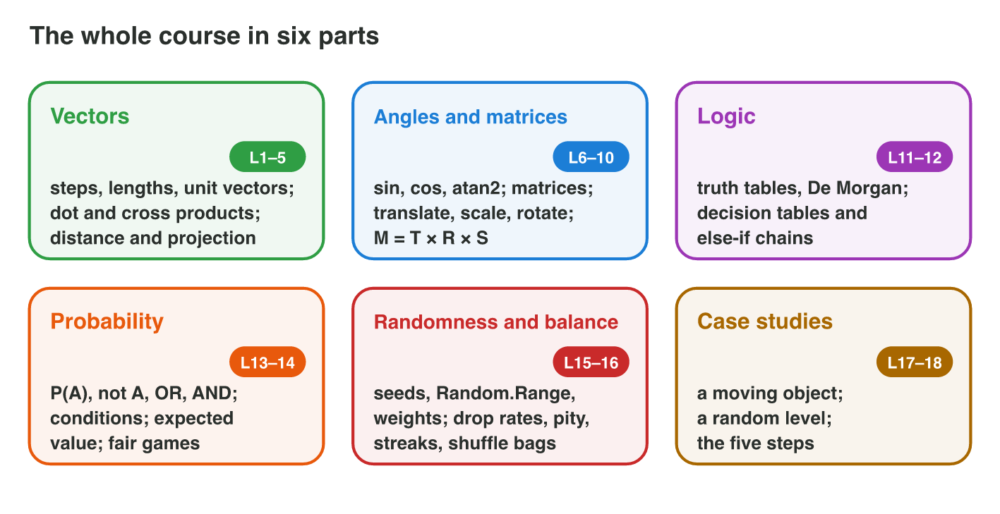

::: {.lead}
This course gave you the mathematics that moves and decides things in a
game. Vectors and their products place, move and aim objects; angles,
matrices and transformations turn and scale them; logic writes the rules of
doors and guards; probability, random numbers and balance shape the luck
that players feel; and the two case studies joined everything in a moving
object and a random level (@fig-map). In this revision lesson you go
through the whole course once more. Each section gives the **key facts**,
one **mixed example** from a game, the most **common mistake**, and a short
task. The last section shows how to **present** a solution, because in this
lesson you also present one problem to the class. The mini-game at the end
takes you past all parts.
:::

## Key terms



{#fig-map width=96%}

## 19.1 Vectors and their products (lectures 1–3)

::: {.callout-important title="Key facts 19.1 — Vectors"}
- The **step** from A to B is B − A; its **length** is $\sqrt{x^2 + y^2}$.
- A **unit vector** is $\vec{v} / |\vec{v}|$; **velocity** = speed × unit
  direction; time = distance ÷ speed.
- **Dot product** $\vec{a} \cdot \vec{b} = a_x b_x + a_y b_y$: positive in
  front, negative behind, 0 perpendicular.
- **2D cross product** $a_x b_y - a_y b_x$: positive to the left,
  negative to the right.
- The part of $\vec{v}$ **along** a unit direction $\hat{u}$ is
  $\vec{v} \cdot \hat{u}$.
:::

{#fig-dot width=90%}

::: {.callout-note title="Example 19.1 — A patrol drone"}
A drone at (1, 1) flies to a tower at (4, 5) at 2.5 units per second. A
guard at (1, 1) looks along $\vec{f} = (0, 1)$.

1. The step is (3, 4); its length is $\sqrt{9 + 16} = 5$; the flight takes
   5 ÷ 2.5 = **2 s**.
2. The unit direction is (0.6, 0.8); the velocity is 2.5 × (0.6, 0.8) =
   **(1.5, 2)**.
3. For the guard, $\vec{f} \cdot (3, 4) = 4 > 0$: the tower is **in front**;
   $\vec{f} \times (3, 4) = 0 \cdot 4 - 1 \cdot 3 = -3 < 0$: it is to the
   **right**.
:::

::: {.callout-warning title="Common mistake"}
Adding the parts for the length: the length of (3, 4) is 5, not 7. Square,
add, then take the square root.
:::

::: {.callout-note title="Do it · A cart"}
A cart rolls from (2, −1) to (8, 7) at 5 units per second. Find the step,
the length, the time and the velocity.

*Your result:* four answers.

::: {.check}
Step (6, 8); length 10; time 10 ÷ 5 = 2 s; velocity 5 × (0.6, 0.8) =
(3, 4).
:::
:::

## 19.2 Angles, matrices and transformations (lectures 4–7)

::: {.callout-important title="Key facts 19.2 — Turning and moving objects"}
- The direction at the angle θ is (cos θ, sin θ); the angle of a vector is
  atan2(y, x).
- A **matrix** times a vector: each row times the column. The identity
  changes nothing; the **inverse** undoes a matrix.
- **Translate** T, **scale** S, **rotate** R(θ); R(90°) turns (x, y) into
  (−y, x).
- **About a pivot** C: subtract C, transform, add C.
- One matrix for an object: **M = T × R × S** (S acts first). A point has
  w = 1 and moves; a direction has w = 0 and only turns.
:::

{#fig-trs width=90%}

::: {.callout-note title="Example 19.2 — The cannon on the ship"}
A cannon sits at (2, 0) in the ship's own space. The ship is turned by 90°
and stands at (5, 1).

1. R(90°) turns (2, 0) into (0, 2); + (5, 1) gives the cannon at **(5, 3)**
   in the world.
2. The cannon fires along the local direction (1, 0). With w = 0 it only
   turns: **(0, 1)**.
3. The angle of (0, 1) is atan2(1, 0) = **90°**: the cannon fires straight
   up the screen.
:::

::: {.callout-warning title="Common mistake"}
Moving a direction like a point: (1, 0) + (5, 1) is not a direction. A
direction (w = 0) never takes the translation.
:::

::: {.callout-note title="Do it · Aim and turn"}
1. A ball is kicked at 30° with the speed 10 (cos 30° ≈ 0.87, sin 30° =
   0.5). Find its velocity.
2. Rotate the point (4, 2) by 90° about the pivot (2, 2).

*Your result:* one velocity and one point.

::: {.check}
1. 10 × (0.87, 0.5) = (8.7, 5). 2. (4, 2) − (2, 2) = (2, 0); R(90°) gives
(0, 2); + (2, 2) = (2, 4).
:::
:::

## 19.3 Logic and decisions (lectures 8–9)

::: {.callout-important title="Key facts 19.3 — Rules"}
- ¬p (NOT), p ∧ q (AND: both), p ∨ q (OR: at least one), p ⊕ q (XOR:
  exactly one), p → q (false only when p is T and q is F).
- The order is NOT, AND, OR; brackets first. A **truth table** with n
  variables has $2^n$ rows.
- **De Morgan:** ¬(p ∧ q) ≡ ¬p ∨ ¬q and ¬(p ∨ q) ≡ ¬p ∧ ¬q.
- A **decision table** has one action in every row. In an **else-if
  chain** the first true rule wins; a rule that the rules above catch
  completely is **unreachable**.
- **Edge cases** for "health < 30": test 29, 30 and 31.
:::

{#fig-dm width=90%}



::: {.callout-note title="Example 19.3 — The chest and the guard"}
1. The chest opens when (k ∨ c) ∧ ¬t: the key or the code, and the trap
   off. Its table has 8 rows; the true rows are (k, c) = (T, T), (T, F),
   (F, T) with t = F: **3 rows**.
2. A guard has `if (health < 30) Flee(); else if (health < 10) Hide();`.
   Every health below 10 is also below 30, so `Hide` is **unreachable**.
   Put the more specific rule (< 10) first.
:::

::: {.callout-warning title="Common mistake"}
Moving a NOT into brackets without swapping the operator: ¬(p ∨ q) is
**not** ¬p ∨ ¬q. The NOT goes in, and OR becomes AND.
:::

::: {.callout-note title="Do it · Simplify and test"}
1. Rewrite ¬(p ∧ ¬q) with De Morgan.
2. Write the edge cases for the rule "shield on when energy ≥ 50".

*Your result:* one condition and three test values.

::: {.check}
1. ¬p ∨ q. 2. 49 (off), 50 (on), 51 (on).
:::
:::

## 19.4 Probability and expected value (lecture 10)

::: {.callout-important title="Key facts 19.4 — Chance and average"}
- Equally likely outcomes: $P(A) = |A| / |S|$; P(not A) = 1 − P(A). Two
  steps with m and k outcomes give m × k pairs (a grid or a tree).
- P(A or B) = P(A) + P(B) − P(A and B). Independent: P(A and B) = P(A) ·
  P(B).
- **Conditional:** count A only inside B. In general P(A and B) = P(A) ·
  P(B | A).
- **Expected value:** E = x₁p₁ + x₂p₂ + …; a game is **fair** when E(win) −
  price = 0; the average number of tries is 1/p.
:::

{#fig-tree width=90%}

::: {.callout-note title="Example 19.4 — Tokens and a dice stand"}
1. A chest holds 2 gold and 3 wood tokens. The player draws two without
   putting them back: P(both gold) = 2/5 × 1/4 = **1/10**.
2. A dice stand costs 2 coins; a 6 wins 6 coins. E(win) = 6 × 1/6 = 1, so
   the expected gain is 1 − 2 = **−1 coin**: not fair. A fair price is 1
   coin.
:::

::: {.callout-warning title="Common mistake"}
Multiplying the first chance twice for draws **without** putting back:
2/5 × 2/5 is wrong. After one gold token is gone, only 1 of 4 is gold.
:::

::: {.callout-note title="Do it · Two dice"}
1. Find P(sum ≥ 10) for two dice with a grid.
2. Find P(a double | sum ≥ 10).

*Your result:* two fractions.

::: {.check}
1. (4,6), (5,5), (6,4), (5,6), (6,5), (6,6): 6/36 = 1/6. 2. Inside these 6,
the doubles are (5,5) and (6,6): 2/6 = 1/3.
:::
:::

## 19.5 Random numbers and balance (lecture 11, 16 and 18)

::: {.callout-important title="Key facts 19.5 — Randomness in a game"}
- A **PRNG** computes each number from the one before; one **LCG** step is
  (a · x + c) mod m. The same **seed** gives the same numbers and the same
  level; **seed once**.
- `Random.Range(min, max)` with integers never gives max; `Random.value < p`
  is a yes with probability p.
- **Weighted:** P(i) = wᵢ ÷ the sum; pick with the cumulative weights.
- **At least one** drop in n tries: 1 − (1 − p)ⁿ; a **pity timer** limits
  the longest wait.
- Independent tries have streaks and no memory; a **shuffle bag** keeps
  the shares exact. **Rejection sampling** needs 1/p draws on average.
:::

{#fig-weighted width=90%}

::: {.callout-note title="Example 19.5 — Loot and a pearl"}
1. Loot weights common 70, rare 25, epic 5: cumulative 70, 95, 100. A draw
   r = 93.4 lies from 70 to 95: **rare**. P(epic) = 5 %.
2. A pearl drops with p = 0.5. In 3 dives: 1 − (1/2)³ = **7/8**, not 100 %.
3. With a shuffle bag of 1 pearl in 4 dives, every player gets exactly one
   pearl in each full bag, and the longest wait is 2(4 − 1) = **6** dives.
:::



::: {.callout-warning title="Common mistake"}
"20 tries at 5 % make 100 %." Chances of tries do not add up: use the
complement, 1 − (1 − p)ⁿ.
:::

::: {.callout-note title="Do it · A loot table"}
1. Weights 50, 30, 15, 5: find each probability and the cumulative
   weights. Which item does r = 81 give?
2. In **Bag Lab**, compare the longest drought of pure random and of the
   shuffle bag.

*Your result:* four probabilities, one item and two droughts.

::: {.check}
1. 50 %, 30 %, 15 %, 5 %; cumulative 50, 80, 95, 100; r = 81 is from 80 to
95: the **third** item. 2. Pure random often 20 or more; the bag at most 6.
:::
:::

## 19.6 Solving and presenting a mixed problem (lectures 17–18‹?›)

::: {.callout-important title="Key facts 19.6 — Solve, then present"}
- **Five steps:** read (given and asked), draw, choose the tool, compute
  with units, check.
- **Present** the solution in the same order (@fig-present): the
  **problem** in one sentence, the **sketch**, the **tool** and why, the
  **steps**, and the **check and answer** in game words.
- About one minute for each part. Speak to the class, not to the board;
  show one number check (a probability between 0 and 1, a sensible size).
- Listen to the other solutions: ask one question about the tool or the
  check.
:::

{#fig-present width=96%}

::: {.callout-note title="Example 19.6 — The courier drone, presented"}
1. *Problem:* "A courier drone flies from (2, 1) to (8, 9) at 5 units per
   second. How long is the flight?"
2. *Sketch and tool:* an arrow from start to goal; the step vector and its
   length (lecture 2).
3. *Steps:* (8, 9) − (2, 1) = (6, 8); length 10; time 10 ÷ 5 = 2 s.
4. *Check and answer:* 5 units per second for 2 s is 10 units. "The drone
   arrives after two seconds."
:::

::: {.callout-warning title="Common mistake"}
Showing only the final number. The class cannot follow or check it.
Name the tool, show the steps, and say the answer as a sentence about the
game.
:::

::: {.callout-note title="Do it · Present one problem"}
A chest has the weights 6, 3 and 1 (common, rare, epic), worth 10, 40 and
200 coins. Find the expected coins per chest, and prepare a five-part
presentation of your solution. Present it to the class (alone, about four
minutes).

*Your result:* a solution in five parts and one presentation.

::: {.check}
E = 0.6 × 10 + 0.3 × 40 + 0.1 × 200 = 6 + 12 + 20 = **38 coins**. A good
presentation has the five parts in order, names the tool (the expected
value), shows the three products and checks that the probabilities add up
to 1.
:::
:::

## Case study: Lucky Raft Finals

*Lucky Raft Finals* is a made-up revision game: the raft sails past eight
islands, one for each part of the course. The problems: the distance from
the beach (1, 2) to the island (7, 10); whether the raft at (−3, 4) is in
front of a lighthouse that looks along (1, 0); a flag at (3, 1) turned by
90° about the mast (1, 1); a dock gate with AND and NOT; a sailing rule with
De Morgan; a sum of two dice; the expected coins of a crate; and a pearl in
two dives. The Game challenge of the interactive page uses these problems.
In the mini-game below you sail past the islands.



## Further reading

Dunn and Parberry, *3D Math Primer for Graphics and Game Development*, 2nd
ed., Chapters 2–5. Rosen, *Discrete Mathematics and Its Applications*, 8th
ed., Chapter 1 (logic) and Chapter 7 (probability). Schreiber and Romero,
*Game Balance* (2021), the chapters on probability and randomness.

## Exercises

1. A drone flies from (0, 0) to (5, 12). How far?
2. Normalize (0, −4).
3. A guard looks along (0, 1). Is a player at d = (2, −3) in front or
   behind?
4. Rotate (1, 0) by 90° about the origin.
5. Where does M = T(2, 3) send the direction (1, 0, 0)?
6. p = T and q = F. Find p → q and ¬p ∨ q.
7. How many rows has the truth table of a rule with 3 conditions?
8. Write ¬(a ∧ b) with De Morgan.
9. Two dice: find P(sum = 4).
10. A bag has 3 red and 1 blue token. Two draws without putting back:
    find P(both red).
11. A crate gives 0 coins with probability 0.5, 20 coins with 0.4 and 100
    coins with 0.1. Find the expected coins.
12. Which values does `Random.Range(0, 4)` give with integers?
13. Two items have the weights 8 and 2. Find P(second item).
14. Drop rate 0.2, two tries: find P(at least one drop).
15. A 25 % critical hit missed five times in a row; the rolls are
    independent. What is the chance of a crit on the next roll?
16. Rejection sampling: one fifth of the candidates is allowed. How many
    draws are needed on average?

## Answers to the exercises

::: {.answers}
1. 13.
2. (0, −1).
3. Behind: (0, 1) · (2, −3) = −3.
4. (0, 1).
5. (1, 0, 0): a direction (w = 0) does not move.
6. Both are F.
7. 2³ = 8.
8. ¬a ∨ ¬b.
9. 3/36 = 1/12.
10. 3/4 × 2/3 = 1/2.
11. 0 + 8 + 10 = 18 coins.
12. 0, 1, 2, 3.
13. 2/10 = 0.2.
14. 1 − 0.8 × 0.8 = 0.36.
15. 25 %: the past does not change the next roll.
16. 5.
:::
