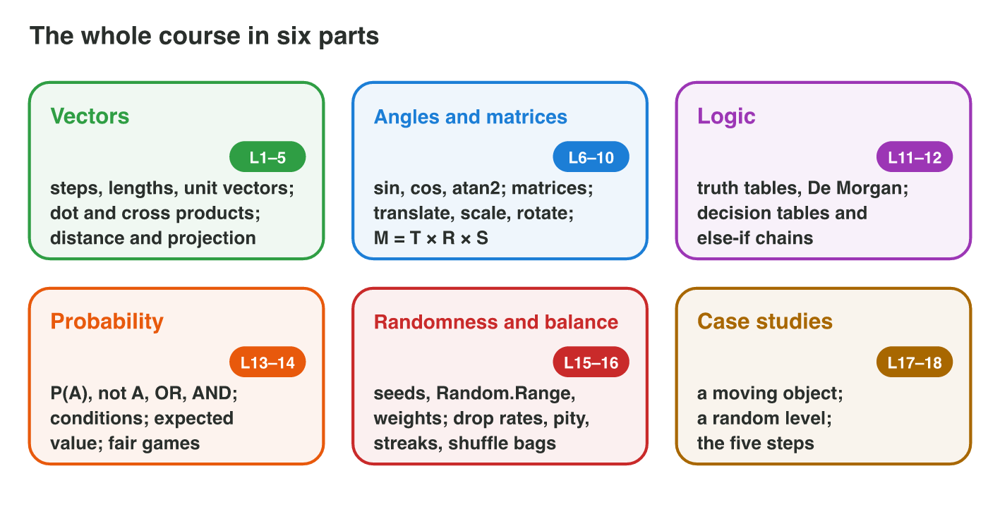
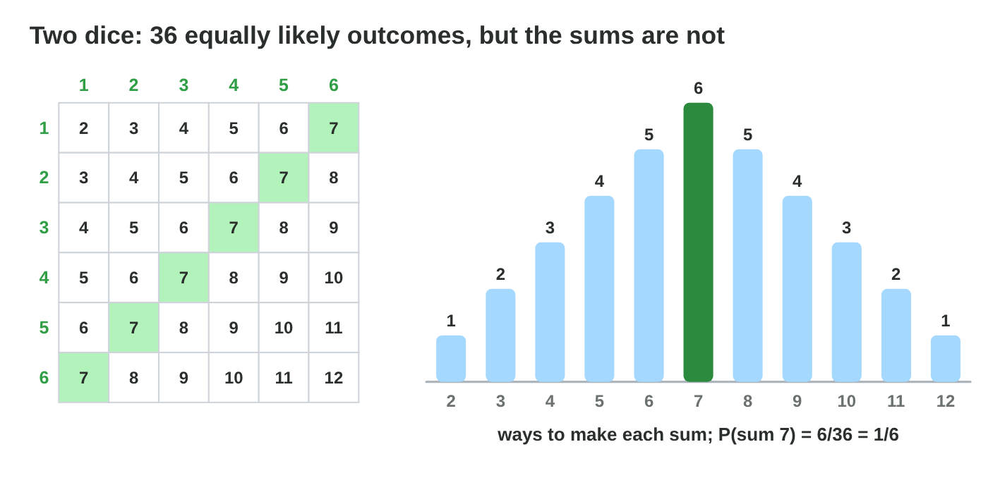
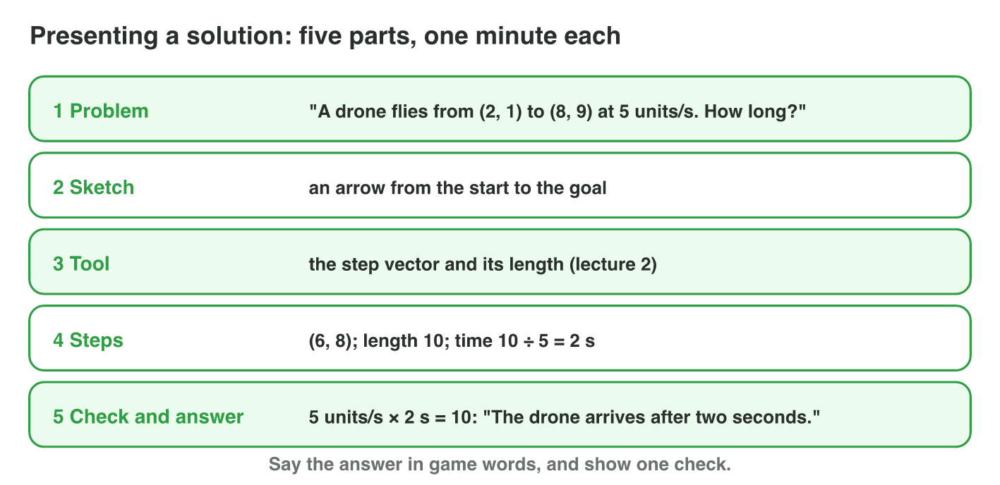

No new ideas today: three short problems that revise Lectures 1–12 before
the final exam. Do each one alone. Tap, sort or type your answer at every
step: the page checks it at once and tells you why.

## Recall

{width=90%}

- **Vectors, angles and transformations (Lectures 1–7):** a step is B − A;
  its length √(x² + y²); the dot product for in front or behind; the point
  at θ is (cos θ, sin θ); rotate about a pivot: move it to the origin,
  rotate, move it back.
- **Logic (Lectures 8–9):** AND, OR, NOT and truth tables; De Morgan:
  ¬(A ∨ B) = ¬A ∧ ¬B.
- **Probability and randomness (Lectures 10–12):** P(not A) = 1 − P(A);
  AND multiplies for independent events; E = x₁p₁ + x₂p₂ + …; a shuffle bag
  spreads the results.

::: {.callout-tip title="Try it 1 · Recall"}
Choose the right answer.

::: {.match extra="7|true"}
What is the length of the vector (6, 8)?
:   10

    Why: √(36 + 64) = √100.

What is ¬(A ∨ B) when A is false and B is true?
:   false

    Why: A ∨ B is true, so its NOT is false.

A drop has p = 0.2. What is P(no drop)?
:   0.8

    Why: 1 − 0.2.
:::
:::

## Activity 1 · Vectors, angles and transformations

The raft of *Lucky Raft* sails past the first islands. The beach is at
(1, 2) and the first island at (7, 10); the raft sails at 2.5 units per
second. A lighthouse at (0, 0) looks along (1, 0), and the raft passes it at
(−3, 4). On the next island, a flag at (3, 1) turns by 90° anticlockwise
about the mast at (1, 1).



::: {.callout-note title="Activity 1 · The first islands · 18 min"}
1. How far is the island from the beach? How long does the raft need?
2. Is the raft in front of the lighthouse or behind it? Use the dot
   product.
3. Where is the flag after the turn? Move the mast to the origin, rotate,
   and move back.

*Your product:* a distance, a time, one decision and one point.

::: {.choice}
Step 1: how far is the island, and how long does the raft need?

- [x] 10 units and 4 seconds

  Why: (7, 10) − (1, 2) = (6, 8), the length is 10, and 10 ÷ 2.5 = 4 s.

- [ ] 14 units and 5.6 seconds

  Why: The length is √(36 + 64) = 10, not 6 + 8.

- [ ] 10 units and 25 seconds

  Why: Time = distance ÷ speed = 10 ÷ 2.5.
:::

::: {.choice}
Step 2: is the raft at (−3, 4) in front of the lighthouse or behind it?

- [x] behind

  Why: (1, 0) · (−3, 4) = −3: negative.

- [ ] in front

  Why: In front needs a positive dot product.

- [ ] exactly to the side

  Why: To the side needs a dot product of 0.
:::

::: {.order}
Step 3: put the steps of the turn about the mast in order.

1. Move the mast to the origin: (3, 1) − (1, 1) = (2, 0).
2. Turn by 90°: (2, 0) → (0, 2).
3. Move back: (0, 2) + (1, 1) = (1, 3).

Why: Subtract the pivot, rotate, add the pivot back.
:::
:::

::: {.callout-tip title="Try it 2 · The first islands"}
Choose the right answer.

::: {.match extra="14|(−1, 3)"}
How far is (7, 10) from (1, 2)?
:   10

    Why: (6, 8) has the length 10, not 6 + 8.

The flag at (3, 1) turns by 180° about the mast (1, 1). Where is it?
:   (−1, 1)

    Why: (2, 0) turned by 180° is (−2, 0); + (1, 1).

Which angle does atan2 give for the vector (0, −4)?
:   −90°

    Why: straight down.
:::
:::

## Activity 2 · Logic, chance and a crate

The next islands test the rest of the course. The dock gate opens with
key ∧ ¬alarm. The raft may sail when ¬(storm ∨ night). A crate gives 10
coins (p = 0.7) or 50 coins (p = 0.3). A pearl is found with p = 0.1 in
each dive. Then play the eight islands of **Lucky Raft Finals**.

{width=72%}

::: {.callout-note title="Activity 2 · The last islands · 18 min"}
1. key = true, alarm = false. Does the gate open? storm = false,
   night = true. May the raft sail?
2. What is P(a sum of 7) with two dice?
3. Find the expected coins of the crate.
4. Find P(at least one pearl in two dives). A shuffle bag gives 1 pearl in
   every 10 dives: what is the longest wait?
5. Play **Lucky Raft Finals**.

*Your product:* two decisions, three probabilities or values, one wait and
your score.

::: {.sort}
Step 1: does the rule say yes? Sort the cases.

Yes
:   the gate: key = true, alarm = false

    Why: true ∧ ¬false = true ∧ true = true.

:   the raft on a clear day: storm = false, night = false

    Why: ¬(false ∨ false) = ¬false = true.

No
:   the raft: storm = false, night = true

    Why: ¬(false ∨ true) = ¬true = false.

:   the gate with the alarm on: key = true, alarm = true

    Why: true ∧ ¬true = true ∧ false = false.
:::

::: {.fill answer="1/6|6/36" hint="Count the pairs with the sum 7 in the grid of 36."}
Step 2: what is P(a sum of 7) with two dice?

Why: (1, 6), (2, 5), (3, 4), (4, 3), (5, 2), (6, 1): 6/36 = 1/6.
:::

::: {.fill answer="22" unit="coins" hint="10 × 0.7 + 50 × 0.3."}
Step 3: what are the expected coins of the crate?

Why: 7 + 15 = 22 coins.
:::

::: {.choice}
Step 4: P(at least one pearl in two dives), and the longest wait with the
bag?

- [x] 0.19, and 18 dives without a pearl at most

  Why: 1 − 0.9 × 0.9 = 0.19; the pearl can be first in one bag and last in the next: 9 + 9.

- [ ] 0.2, and 10 dives at most

  Why: 0.1 + 0.1 counts the case of two pearls twice, and two bags can give 9 + 9.

- [ ] 0.01, and 18 dives at most

  Why: 0.01 = 0.1 × 0.1 is P(two pearls).
:::
:::

::: {.callout-tip title="Try it 3 · The last islands"}
Choose the right answer.

::: {.match extra="0.1|20 dives"}
What is key ∧ ¬alarm with key = true and alarm = true?
:   false

    Why: ¬alarm is false, so the AND is false.

A crate gives 20 coins (p = 0.5) or nothing (p = 0.5). What is E?
:   10

    Why: 20 × 0.5 + 0.

What is P(no pearl in two dives) with p = 0.1?
:   0.81

    Why: 0.9 × 0.9: the dives are independent.
:::
:::

## Activity 3 · Present one solution

A good solution is easy to follow: read, draw, choose the tool, compute,
check. You present it alone in five parts: the problem, a sketch, the tool
and why, the steps, and the check with the answer in game words.

{width=92%}

::: {.callout-note title="Activity 3 · Present it · 18 min"}
A chest of *Lucky Raft* gives 10 coins, 40 coins or 200 coins with the
weights 6, 3 and 1 (out of 10).

1. Find the expected coins of the chest.
2. Prepare the five parts on one page: problem, sketch, tool, steps, check
   and answer.
3. Present your solution alone in about four minutes.

*Your product:* one page with the five parts, and your talk.

::: {.fill answer="38" unit="coins" hint="10 × 0.6 + 40 × 0.3 + 200 × 0.1."}
Step 1: what are the expected coins of the chest?

Why: 6 + 12 + 20 = 38 coins; check: 0.6 + 0.3 + 0.1 = 1.
:::

::: {.order}
Step 2: put the five parts of the presentation in order.

1. the problem
2. a sketch
3. the tool and why (the expected value)
4. the steps: the three products and their sum
5. the check and the answer in game words

Why: Read, draw, choose the tool, compute, check: a solution that is easy to follow.
:::

::: {.choice}
Step 3: which answer sentence is in game words?

- [x] "On average a chest gives 38 coins."

  Why: It says what the number means for the player.

- [ ] "E = 38."

  Why: Right, but it does not say what it means in the game.

- [ ] "The probabilities add up to 1."

  Why: That is the check, not the answer.
:::
:::

::: {.callout-tip title="Try it 4 · Presenting"}
Choose the right answer.

::: {.match extra="the answer only|the slides"}
What comes first in a presentation of a solution?
:   the problem in one sentence

    Why: the listener must know the question before the steps.

How do you say the answer?
:   in game words

    Why: "38 coins per chest" means more than "38".

Which check fits a probability of 1.3?
:   it must be between 0 and 1

    Why: no probability is more than 1.
:::
:::

## Wrap-up {.summary}

- You can solve vector, angle and transformation problems of a game.
- You can solve logic, probability and randomness problems of a game.
- You can present a solution in five parts, alone.
